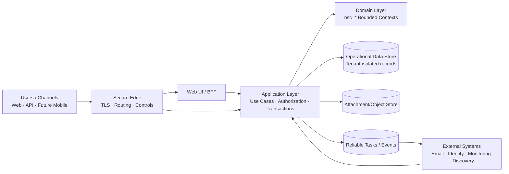

# NexusServiceCloud Enterprise Architecture

> Document ID: NSC-EA-ARCH-01  
> Version: 1.0.0  
> Date: 2026-11-09  
> Status: Reference Architecture (Proposed for Review)  
> Owner: Product Architecture / Governance Review  
> Scope: NexusServiceCloud documentation package

## 1. Purpose

This document provides an enterprise architecture reference for **NexusServiceCloud**, a proposed unified platform for service management and technical support. It aligns repository-level documentation with a consistent model for bounded contexts, layers, governance, and delivery boundaries.

This is a design/reference artifact. It does **not** claim an implemented platform, a complete API, production readiness, or operational test success.

## 2. Business and Domain Intent

NexusServiceCloud targets the operating model of an enterprise service desk and extended service management (ESM):

| Area | Target capability |
|---|---|
| Service desk | Incident and service request intake, triage, assignment, communication, and resolution tracking |
| Service levels | SLA/OLA policies, calendars, measurement segments, escalation, and reporting inputs |
| Operational control | Problem management, known errors, change control, approvals, releases, and delivery records |
| Knowledge | Reviewable, audience-scoped knowledge linked to operational records |
| Resources | Asset, CMDB/configuration-item, procurement, contract, maintenance, and reservation relationships |
| Multi-tenancy | Independent organization/tenant isolation; departments/service desks inside a tenant are not separate tenants by default |
| Governance | RBAC/ABAC decisions, audit evidence, architecture decisions, traceability, and review controls |

The NexusAsset CloudMonorepo is used only as an organizational/reference pattern for documentation and separation of concerns. NexusServiceCloud does not adopt asset-discovery scope, Lansweeper integration, pricing plans, or package/version baselines from that reference.

## 3. Architecture Principles

| Principle | Application in NexusServiceCloud |
|---|---|
| Separation of concerns | Delivery interfaces, application use cases, domain rules, infrastructure adapters, and governance are documented separately. |
| Bounded contexts | Each business capability has explicit ownership, interfaces, and lifecycle boundaries. |
| Dependency direction | Dependencies point inward: `Interfaces -> Application -> Domain`. |
| Domain purity | Domain rules do not depend on HTTP, ORM, UI frameworks, queues, or external providers. |
| Server-side authorization | Every operation and object access is authorized on the server; UI visibility is not sufficient. |
| Clear consistency boundaries | State transitions, history, audit evidence, and reliable events define explicit transaction boundaries. |
| Defense-in-depth tenancy | Tenant isolation is enforced through identity context, application checks, and data-level controls in the target design. |
| Integration safety | External integrations use explicit contracts, idempotency/reconciliation rules, observability, and compensation where needed. |
| Documentation-driven governance | Requirements, decisions, traceability, and acceptance criteria must be reviewable before implementation claims. |

## 4. Target Architecture Style

**Initial target style:** Modular Monolith with Domain-Driven Design and Clean Architecture boundaries.

Rationale (proposed):

- Service request lifecycles benefit from strong transactional consistency.
- Early phases need lower distributed-systems complexity.
- Bounded contexts can still be separated logically and prepared for later extraction if metrics or team boundaries justify it.
- Extraction to independent services is a later decision, supported by load evidence, operational readiness, and ADRs.

## 5. Logical Layers

| Layer | Responsibility | Must not own |
|---|---|---|
| Presentation / channels | Web UI, future mobile clients, administrative views, API consumers, BFF composition | Business invariants or final authorization |
| Application | Use cases, workflow orchestration, transaction boundaries, permission checks, event publication intent | UI details, database-specific rules, external API protocols |
| Domain | Entities/value objects/policies, state transitions, domain events, business invariants | HTTP, ORM, messaging SDKs, provider-specific behavior |
| Infrastructure | Persistence, identity providers, file storage, messaging, email, monitoring connectors, schedulers | Core business decisions |
| Governance / operations | ADRs, traceability, policies, runbooks, acceptance criteria, risk controls | Runtime product behavior as implementation |

## 6. Proposed Bounded Contexts

| Context | Primary responsibility | Key boundary rule |
|---|---|---|
| `nsc_identity` | Identity, sessions, memberships, delegation, authorization inputs | Does not decide business workflow state transitions. |
| `nsc_tenants` | Organizations, sites, departments, service desks, structural grouping | Organization is the tenant boundary; department is not automatically a tenant. |
| `nsc_catalog` | Services, catalog items, forms, audiences, published request definitions | Catalog defines requestable offerings, not request execution state. |
| `nsc_requests` | Incidents, service requests, comments, assignment, state history | Owns the request record as the operational source of truth. |
| `nsc_service_levels` | SLA/OLA policies, calendars, pause rules, escalation, measurement segments | Consumes request events; does not own request content. |
| `nsc_approvals` | Approval policies, steps, decisions, delegation, invalidation rules | Executes approval decisions through explicit application contracts. |
| `nsc_problems` | Root-cause analysis, workarounds, known errors, incident linkage | Linked to incidents/changes without replacing the original incident record. |
| `nsc_changes` | RFCs, risk assessment, CAB/approval integration, implementation, rollback, scheduling | Change records are controlled separately from incident closure. |
| `nsc_delivery` | Projects, tasks, dependencies, releases, deployment records | Delivery tracking does not replace change approval/control. |
| `nsc_assets` | Asset ownership, custody, movement, maintenance, reservation, retirement | Physical asset lifecycle is distinct from configuration-item modeling. |
| `nsc_cmdb` | Configuration items, dependency relationships, impact maps | CI relationships may reference assets but are not identical to asset inventory. |
| `nsc_procurement` | Purchase requests, receiving, vendors, contracts, service-related procurement records | Not a general ledger or full ERP accounting system. |
| `nsc_knowledge` | Articles, versions, review, publication state, audience | Knowledge visibility follows authorization and audience rules. |
| `nsc_integrations` | Email, monitoring, discovery connectors, field mappings, reconciliation | Integration adapters do not become owners of core business records. |
| `nsc_insights` | Reports, derived read models, surveys, freshness declarations | Derived views must not exceed source authorization scope. |
| `nsc_audit` | Audit events, evidence trails, sensitive action records | Records decisions/events; does not alter the original business decision. |
| `nsc_notifications` | Notification templates, channels, delivery attempts, receipts | Delivery state is separate from business approval/request state. |
| `nsc_ai` | Permission-aware suggestions, summaries, drafts, review controls | AI output is assistive, reviewable, and fully disableable. |

## 7. Context and Data Flow (Target)

## 8. Multi-Tenancy and ESM Model

| Concept | Target rule |
|---|---|
| Tenant | An organization with isolated data, configuration, policies, and audit scope. |
| Department / service desk | An operating structure inside a tenant; may have separate catalog visibility, queues, and policies. |
| ESM | Multiple service desks/departments (IT, HR, Facilities, etc.) can operate within the same tenant with scoped access. |
| Isolation | Cross-tenant access is denied by default; platform operations require explicit, auditable controls. |
| Data ownership | Every business record includes tenant ownership and authorization scope in the target model. |

## 9. Governance Model

| Governance artifact | Purpose |
|---|---|
| ADRs (`docs/12-adr/`, overview references) | Record significant architecture decisions, alternatives, and consequences. |
| Traceability (`docs/11-governance/`) | Link sources, requirements, design, acceptance criteria, and future verification evidence. |
| Documentation policy (`project-meta/`) | Define information states, review rules, and limits on implementation claims. |
| Acceptance planning (`docs/04-testing/`) | Define future verification scenarios without claiming executed tests. |
| Security/privacy design (`docs/07-security/`, `docs/14-appendices/`) | Define target controls, threat considerations, and data-protection boundaries. |

## 10. Repository Documentation Map

| Need | Path |
|---|---|
| Main entry | `README.md`, `README_EN.md`, `README_AR.md` |
| Enterprise architecture reference | `EnterpriseArchitecture.md` |
| Vision and scope | `docs/00-overview/` |
| Analysis and requirements | `docs/01-analysis/` |
| Detailed design | `docs/02-design/` |
| Future implementation blueprint constraints | `docs/03-implementation/` |
| Future acceptance/verification plans | `docs/04-testing/` |
| Deployment/recovery design | `docs/05-deployment/`, `docs/16-operations/` (if present) |
| Operations design | `docs/06-operations/` |
| Security, API, mobile, design system | `docs/07-security/`, `docs/08-mobile/`, `docs/09-api/`, `docs/10-design-system/` |
| Governance, ADRs, diagrams, appendices | `docs/11-governance/`, `docs/12-adr/`, `docs/13-diagrams/`, `docs/14-appendices/` |
| Documentation audit | `docs/documentation-audit/` |
| Project governance/policy | `project-meta/` |

## 11. Delivery Boundaries

- This package is documentation-first and review-oriented.
- Mermaid diagrams and blueprints are explanatory artifacts, not executable systems.
- Technology families may be discussed as candidates; versions, pricing, AI costs, trial terms, and deployment commitments require separate decisions.
- Preserved root reference files (`Architecture.md/.txt`, `Enterprise Repository Structure.md/.txt`) must remain unchanged unless explicitly requested.
- Implementation work requires a separate user request and must not be inferred from architecture/design completeness.

## 12. Related NexusServiceCloud Documents

- [Architecture and responsibility boundaries](docs/02-design/01-architecture.md)
- [Data model and consistency rules](docs/02-design/02-data-model.md)
- [Workflows and approvals](docs/02-design/03-workflows.md)
- [SLA/OLA design](docs/02-design/04-service-levels.md)
- [Traceability matrix](docs/11-governance/02-traceability.md)
- [Decisions and risks](docs/11-governance/01-decisions-risks.md)
- [Documentation map](docs/README.md)
