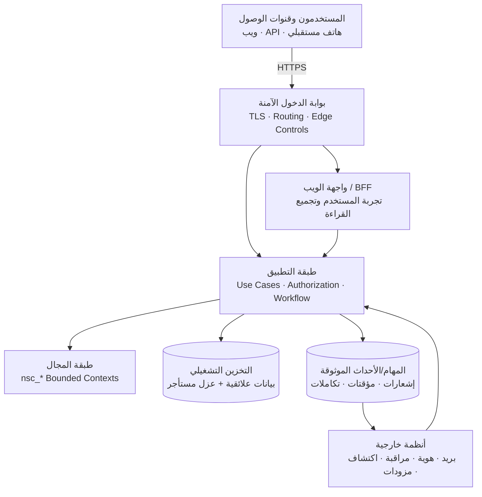

::: {dir="rtl" align="right"}
# NexusServiceCloud

### منصة موحّدة لإدارة الخدمات والدعم الفني المؤسسي

<p align="center">
<strong>من استقبال الطلب إلى التشغيل والحوكمة والتحسين المستمر</strong><br/>
حزمة تحليل وتصميم لمنصة ITSM/ESM تربط الحوادث وطلبات الخدمة بالمشكلات والتغييرات والإصدارات والمعرفة والأصول والمشتريات والعقود.
</p>

<p align="center">


</p>

[README الرئيسي](README.md) · [English](README_EN.md) · [Enterprise Architecture](EnterpriseArchitecture.md)

:::

---

## 1. نبذة عن المشروع

**NexusServiceCloud** مشروع تحليلي وتصميمي يهدف إلى بناء تصور مؤسسي لمنصة موحدة لإدارة الخدمات والدعم الفني. تركز الرؤية على توحيد استقبال الحوادث وطلبات الخدمة، إدارتها وفق اتفاقيات مستوى الخدمة، وربطها بسياق تشغيلي أوسع يشمل المشكلات والتغييرات والإصدارات والمعرفة والأصول والمشتريات والعقود.

تجمع الرؤية المجالات والقدرات التالية:

| المجال | الوصف المستهدف |
|---|---|
| **مكتب الخدمة** | استقبال وإدارة الحوادث وطلبات الخدمة من قنوات متعددة ضمن سجل موحد. |
| **الكتالوج والنماذج** | تعريف خدمات وعناصر كتالوج ونماذج طلب بحسب الجمهور والسياسات. |
| **SLA/OLA** | حساب زمن الاستجابة والحل، تقاويم العمل، الإيقاف، والتصعيد. |
| **المشكلات والتغييرات** | ربط الحوادث بالأسباب الجذرية والحلول المؤقتة وطلبات التغيير والإصدارات. |
| **المعرفة** | إنشاء ومراجعة ونشر مقالات قابلة للربط بالتذاكر وذات جمهور واضح. |
| **الأصول وCMDB** | ربط الطلبات بالأصول وعناصر التكوين والعلاقات والأثر، عند اعتماد هذا النطاق. |
| **المشتريات والعقود** | تتبع طلبات الشراء والاستلام والموردين والعقود ذات الصلة بالخدمة. |
| **التدقيق والحوكمة** | تسجيل القرارات والأحداث الحساسة وتطبيق صلاحيات وعزل مؤسسي. |

> **طبيعة المستودع:** هذه حزمة مواصفات مستهدفة للمراجعة. لا ينبغي اعتبار وجود وثائق أو مخططات أو هياكل مقترحة دليلاً على اكتمال وظائف النظام أو جاهزيتها للإنتاج.

## 2. معلومات المستودع

| البند | القيمة |
|---|---|
| اسم المشروع | NexusServiceCloud |
| الإصدار الوثائقي | `1.0.0` |
| طبيعة المشروع | حزمة تحليل وتصميم مؤسسي |
| حالة العمل | تصميم مقترح للمراجعة |
| مرجع الترخيص/السياسات | `project-meta/` |
| نطاق المستند | التعريف بالمشروع، بنية المستودع، المعمارية المستهدفة، وحدود التسليم |

## 3. بنية المستودع

تم تنظيم المستودع للفصل بين التوثيق التحليلي والتصميمي، وتعليمات المراجعة/الضبط، وملفات الحوكمة، مع الحفاظ على المدخلات المرجعية الأصلية.

```text
.
├── README.md
├── README_EN.md
├── README_AR.md
├── EnterpriseArchitecture.md
│
├── docs/                         # التوثيق المؤسسي
│   ├── 00-overview/
│   ├── 01-analysis/
│   ├── 02-design/
│   ├── 03-implementation/        # توصيف مستقبلي/قواعد اعتماد، ليس تنفيذًا
│   ├── 04-testing/               # سيناريوهات قبول/تحقق مستقبلية
│   ├── 05-deployment/            # تصميم نشر وتعافٍ مستقبلي
│   ├── 06-operations/            # دليل تشغيل مقترح
│   ├── 07-security/
│   ├── 08-mobile/
│   ├── 09-api/
│   ├── 10-design-system/
│   ├── 11-governance/
│   ├── 12-adr/
│   ├── 13-diagrams/
│   ├── 14-appendices/
│   └── documentation-audit/
│
├── prompts/                      # تعليمات مراجعة وضبط الوثائق
├── project-meta/                 # سياسة التوثيق والحوكمة وسجل التغييرات
│
├── Architecture.md               # مدخل مرجعي محفوظ
├── Architecture.txt              # مدخل مرجعي محفوظ
├── Enterprise Repository Structure.md   # مدخل مرجعي محفوظ
└── Enterprise Repository Structure.txt  # مدخل مرجعي محفوظ
```

### مسؤولية المجلدات الرئيسية

| المجلد/الملف | المسؤولية |
|---|---|
| `docs/` | مرجع التحليل، المتطلبات، التصميم، الأمن، الحوكمة، والقبول المستقبلي. |
| `prompts/` | تعليمات تمنع خلط التوثيق بالتنفيذ ضمن هذا التكليف. |
| `project-meta/` | سياسات ضبط الوثائق، حالات المعلومات، وسجل التغيير. |
| `README*.md` | مداخل تعريفية للمشروع بمستويات تفصيل مختلفة. |
| `EnterpriseArchitecture.md` | مرجع معماري مؤسسي يربط التنظيم والحوكمة بالتصميم. |
| ملفات `Architecture*` و`Enterprise Repository Structure*` | مدخلات مرجعية تاريخية/مقارنة محفوظة دون تعديل. |

## 4. المعمارية المستهدفة

تعتمد الرؤية نمطًا يبدأ بـ **Modular Monolith** مقسم إلى وحدات أعمال مستقلة منطقيًا، مع فصل واضح بين واجهات التسليم، حالات الاستخدام، مجال الأعمال، والبنية التحتية. يهدف ذلك إلى وضوح المسؤوليات وإمكانية التطور المرحلي قبل أي قرار بفصل الخدمات.

### 4.1 طبقات وقنوات النظام

| الطبقة | الدور المستهدف |
|---|---|
| قنوات الوصول | بوابة ويب، واجهات API، واستراتيجية هاتف لاحقة |
| بوابة الدخول | TLS، توجيه، وضوابط حافة |
| واجهة الويب/BFF | عرض النماذج وحالة العمليات وتجميع قراءات الشاشة |
| التطبيق | تنسيق حالات الاستخدام، التفويض، المعاملات، ونشر الأحداث |
| المجال | قواعد العمل، الكيانات، السياسات، وانتقالات الحالة |
| البيانات | مصدر الحقيقة التشغيلي، عزل مستأجر، وفهارس/قراءات مناسبة |
| الخلفية والتكامل | إشعارات، مؤقتات SLA، استيراد، موصلات، وأحداث موثوقة |

### 4.2 مخطط معماري مبسط



### 4.3 قواعد معمارية أساسية

1. **اتجاه الاعتماد إلى الداخل:** المجال لا يعتمد على أطر التسليم أو التخزين أو المزودات الخارجية.
2. **التفويض في الخادم:** الواجهة لا تمنح صلاحية نهائية؛ القرار النهائي لكل عملية وكائن في الخادم.
3. **حدود المعاملات واضحة:** تحديث الحالة والتاريخ والتدقيق والحدث الموثوق ضمن معاملة محددة.
4. **العزل المؤسسي:** المؤسسة/المستأجر وحدة عزل؛ القسم أو مكتب الخدمة داخلها ليس مستأجرًا تلقائيًا.
5. **التكامل بعقود صريحة:** البريد والمراقبة والاكتشاف والهوية تتكامل عبر منافذ/عقود قابلة للرصد والتعويض.

## 5. وحدات المجال المقترحة

| الوحدة | المسؤولية الأولية |
|---|---|
| `nsc_identity` | الهوية، الجلسات، العضويات، التفويض. |
| `nsc_tenants` | المؤسسات، المواقع، الأقسام، مكاتب الخدمة. |
| `nsc_catalog` | الخدمات، عناصر الكتالوج، النماذج، الجمهور. |
| `nsc_requests` | الطلبات، الحوادث، التعليقات، التعيين، سجل الحالة. |
| `nsc_service_levels` | SLA/OLA، التقاويم، مقاطع القياس، التصعيد. |
| `nsc_approvals` | سياسات الموافقة، القرارات، التفويض. |
| `nsc_problems` | السبب الجذري، الحلول المؤقتة، الأخطاء المعروفة. |
| `nsc_changes` | RFC، المخاطر، التنفيذ، التراجع، الجدولة. |
| `nsc_delivery` | المشاريع، المهام، التبعيات، الإصدارات، النشر المسجل. |
| `nsc_assets` | الأصل، العهدة، الحركة، الصيانة، التقاعد، الحجز. |
| `nsc_cmdb` | عناصر التكوين وعلاقات الاعتماد وخرائط الأثر. |
| `nsc_procurement` | الشراء، الاستلام، المورد، العقد. |
| `nsc_knowledge` | المقالات، النسخ، المراجعة، النشر، الجمهور. |
| `nsc_integrations` | الموصلات، البريد، المراقبة، خرائط الحقول. |
| `nsc_insights` | تقارير وقراءات مشتقة واستبيانات. |
| `nsc_audit` / `nsc_notifications` | التدقيق والتسليم دون تغيير قرار العمل. |
| `nsc_ai` | اقتراحات مساعدة خاضعة للصلاحيات والمراجعة وقابلة للتعطيل. |

## 6. مسار التنفيذ/المراجعة المرحلي

يناسب هذا المستودع مراجعة وتحسين التصميم على مراحل قبل أي تنفيذ برمجي:

1. حسم الرؤية، النطاق، المصطلحات، والأدوار.
2. تثبيت المتطلبات الوظيفية وغير الوظيفية ومعايير القبول.
3. مراجعة المعمارية، حدود الوحدات، ونموذج البيانات.
4. مراجعة SLA/OLA، سير العمل، والموافقات.
5. مراجعة الأمن، العزل، التدقيق، والخصوصية.
6. مراجعة العقود المفاهيمية للتكاملات وواجهات API.
7. إعداد خطط تحقق/قبول مستقبلية قبل أي بناء تنفيذي.

## 7. مداخل التوثيق

| الموضوع | المسار |
|---|---|
| نظرة عامة ورؤية | `docs/00-overview/` |
| تحليل الأعمال والمتطلبات | `docs/01-analysis/` |
| المعمارية والتصميم | `docs/02-design/` |
| هيكل مستقبلي وقواعد اعتماد | `docs/03-implementation/` |
| قبول واختبارات مستقبلية | `docs/04-testing/` |
| نشر وتعافٍ مستقبلي | `docs/05-deployment/` |
| تشغيل مقترح | `docs/06-operations/` |
| الأمن | `docs/07-security/` |
| الهاتف | `docs/08-mobile/` |
| واجهات API | `docs/09-api/` |
| نظام التصميم | `docs/10-design-system/` |
| الحوكمة والتتبع | `docs/11-governance/` |
| قرارات معمارية | `docs/12-adr/` |
| مخططات | `docs/13-diagrams/` |
| ملاحق ومصادر | `docs/14-appendices/` |
| تدقيق التوثيق | `docs/documentation-audit/` |
| سياسات المشروع | `project-meta/` |

## 8. حدود التسليم

- الحزمة توثيقية (Markdown)؛ لا شيفرة تشغيلية مكتملة ضمن هذا التسليم.
- المقترحات التقنية والتنظيمية تحتاج اعتمادًا صريحًا قبل التنفيذ.
- لا يُنقل إلى هذا المشروع نطاق اكتشاف أصول NexusAsset أو اعتماد Lansweeper.
- لا تُعتمد إصدارات حزم/أسعار/تكاليف AI/تجربة مجانية دون قرار مالك المنتج.
- عند التعارض مع مدخلات مرجعية محفوظة في الجذر، تُراجع حزمة NexusServiceCloud وسجل المصادر.

---
<div dir="rtl" align="center">

**NexusServiceCloud**  
توثيق واضح · حدود مسؤولية صريحة · تصميم قابل للمراجعة · تنفيذ لاحق مضبوط

</div>
