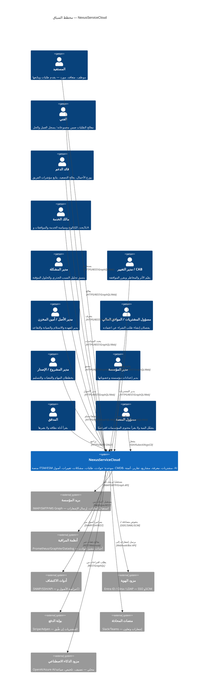
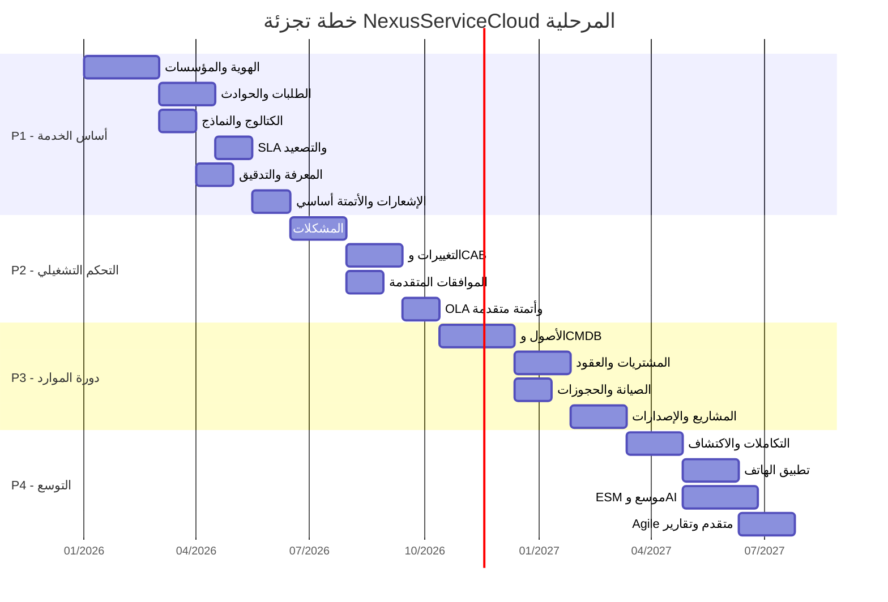

# DOC-01: الرؤية والنطاق — NexusServiceCloud

---

| **معرّف الوثيقة** | DOC-01 |
|-------------------|--------|
| **العنوان** | الرؤية والنطاق وخطة التجزئة |
| **الإصدار** | 1.0.0 |
| **الحالة** | ✓ معتمد |
| **المالك** | مالك المنتج / هندسة المؤسسة |
| **تاريخ التحديث** | 2026-11-09 |
| **التصنيف** | داخلي — سري |
| **الوثائق ذات الصلة** | [DOC-00 الفهرس الرئيسي](../00-overview/00-master-index.md)، [DOC-02 تحليل الأعمال](../00-overview/02-business-analysis.md)، [DOC-05 هندسة التطبيق](../00-overview/05-application-architecture.md)، [DOC-06 هندسة البنية التحتية](../00-overview/06-infrastructure-architecture.md) |
| **التتبع** | CAP-010..080، PROC-010..090، ADR-001..004، DIA-C4-001، SLO-BIZ-### |

---

## 1. ملخص تنفيذي

تحدد هذه الوثيقة **الرؤية الاستراتيجية** والنطاق الوظيفي وخطة التجزئة المرحلية لـ **NexusServiceCloud** — منصة موحدة لإدارة الخدمات والدعم الفني (ITSM/ESM). تستهدف المنصة توحيد استقبال الحوادث وطلبات الخدمة، إدارتها وفق اتفاقيات مستوى الخدمة (SLA/OLA)، وربطها بالمشكلات والتغييرات والإصدارات والمعرفة والأصول والمشتريات والعقود. تدعم الرؤية **أقسامًا متعددة داخل المؤسسة** (ESM) مع **عزل مؤسسات مستقل** في النشر السحابي (Multi-tenant).

---

## 2. سياق النظام (C4 Level 1)

### 2.1 الفاعلون الخارجيون والأنظمة

| الفاعل/النظام | النوع | التفاعل | البروتوكول | الملاحظات |
|---------------|------|----------|------------|----------|
| **المستفيد** | بشري | تقديم/متابعة طلبات، تقييم خدمة | HTTPS/Web | بوابة ذاتية الخدمة |
| **الفني** | بشري | معالجة، تسجيل عمل، اقتراح معرفة | HTTPS/Web | واجهة عامل الدعم |
| **قائد الدعم** | بشري | توزيع، تصعيد، مؤشرات | HTTPS/Web | لوحة قيادة الفريق |
| **مالك الخدمة** | بشري | كتالوج، SLA، موافقات | HTTPS/Web | حوكمة الخدمة |
| **مدير المشكلة** | بشري | RCA، الحلول المؤقتة، الأخطاء المعروفة | HTTPS/Web | وحدة المشكلات |
| **مدير التغيير/CAB** | بشري | تقييم أثر، موافقة، مراجعة | HTTPS/Web | وحدة التغييرات |
| **مدير الأصل/أمين المخزن** | بشري | عهدة، استلام، صيانة، تقاعد | HTTPS/Web | وحدة الأصول |
| **المشتريات/المالي** | بشري | طلب شراء، اعتماد، مورد، عقد | HTTPS/Web | وحدة المشتريات |
| **مدير المشروع/الإصدار** | بشري | مهام، تبعيات، نشر، تراجع | HTTPS/Web | وحدة التسليم |
| **مدير المؤسسة** | بشري | إعدادات، عضويات، سياسات | HTTPS/Web | إدارة المستأجر |
| **المدقق** | بشري | قراءة أدلة التدقيق فقط | HTTPS/Read-Only | للامتثال |
| **مسؤول المنصة** | بشري | تشغيل البنية التحتية | SSH/K8s/ArgoCD | لا يصل لمحتوى المؤسسات |
| **بريد المؤسسة** | نظام | قناة طلبات وإشعارات | IMAP/SMTP/Graph | تحويل بريد → تذكرة |
| **أنظمة المراقبة** | نظام | أحداث → حوادث | Webhook/REST | تنبيه → حادث آلي |
| **أدوات الاكتشاف** | نظام | مزامنة أصول/CI | SNMP/SSH/API | اكتشاف دوري/دفعي |
| **مزود الهوية** | نظام | SSO، تزويد مستخدمين | OIDC/SAML/SCIM | تفويض المصادقة |
| **بوابة الدفع** | نظام | دفع المشتريات | REST/Webhook | اختياري |
| **منصات المحادثة** | نظام | إشعارات، تعاون | Webhook/Bot | Slack/Teams |
| **مزود الذكاء الاصطناعي** | نظام | تصنيف، تلخيص، صياغة | REST | قابل للتعطيل بالكامل |

---

## 3. المشكلة والقيمة

| البعد | الوصف |
|--------|--------|
| **الألم الحالي** | تشتت الطلبات بين البريد والمحادثات يضعف المتابعة؛ غياب ربط الأعطال بالأصول والمشكلات يجعل الحلول تتكرر؛ لا يوجد قياس موحد لزمن الخدمة؛ المعرفة الناتجة تضيع في سلاسل البريد. |
| **الافتراض** | سجل موحد للعمل + مسؤول واضح لكل طلب + قياس زمن الخدمة + حفظ المعرفة = تقليل زمن الحل، تحسين الامتثال، تمكين التحسين المستمر. |
| **المقاييس المستهدفة** | لا نفترض أرقام وفر أو إنتاجية مثبتة؛ تقاس قبل التجربة وبعدها (انظر [DOC-03 متطلبات غير وظيفية](../00-overview/03-requirements-specification.md#32-mقاييس-النجاح-غير-الوظيفية)). |

---

## 4. نطاق المنتج (Product Scope)

### 4.1 المفاهيم الأساسية

| المفهوم | التعريف |
|----------|---------|
| **الخدمة (Service)** | قدرة تقدمها المؤسسة للمستفيد (مثال: البريد المؤسسي). |
| **عنصر الكتالوج (Catalog Item)** | طلب محدد قابل للتقديم ضمن خدمة (مثال: إنشاء صندوق بريد). |
| **الحادث (Incident)** | انقطاع أو تدهور غير مخطط للخدمة. |
| **طلب الخدمة (Service Request)** | احتياج معتاد ومخطط (طلب جهاز، إذن وصول، إلخ). |
| **مكتب الخدمة (Service Desk)** | نقطة الاتصال الوحيدة للمستفيدين؛ يدير دورة حياة الطلب. |
| **ESM (Enterprise Service Management)** | امتداد مكاتب الخدمة لأقسام أخرى (HR، Finance، Facilities) بسياسات وصول مستقلة؛ **القسم ليس مستأجرًا مستقلًا تلقائيًا**. |

### 4.2 القدرات المشمولة (In Scope)

| المجموعة | القدرات (مرتبطة بـ CAP-###) |
|----------|------------------------------|
| **مكتب الخدمة والكتالوج** | CAP-010 (إدارة الطلبات)، CAP-020 (الكتالوج والنماذج)، CAP-030 (التصنيف والتعيين) |
| **إدارة مستوى الخدمة** | CAP-040 (SLA/OLA، التقاويم، التصعيد)، CAP-050 (المقاييس والتقارير) |
| **إدارة المشكلات** | CAP-060 (RCA، الحلول المؤقتة، الأخطاء المعروفة) |
| **إدارة التغييرات** | CAP-070 (RFC، تقييم الأثر، CAB، التنفيذ، المراجعة) |
| **إدارة الأصول وCMDB** | CAP-080 (الأصول، CI، العلاقات، العهدة، الصيانة، التقاعد) |
| **المشتريات والعقود** | CAP-090 (طلب شراء، اعتماد، استلام، مورد، عقد، ضمان) |
| **قاعدة المعرفة** | CAP-100 (مقالات، نسخ، مراجعة، جمهور، ربط بالتذكرة) |
| **المشاريع والإصدارات** | CAP-110 (مشاريع، مهام، تبعيات، مراحل، إصدارات، نشر) |
| **الأتمتة والإشعارات** | CAP-120 (قواعد، محاكاة، قنوات، إعادة محاولة، Outbox) |
| **التكاملات** | CAP-130 (بريد، مراقبة، اكتشاف، موصلات، خرائط حقول) |
| **مساعدة الذكاء الاصطناعي** | CAP-140 (تصنيف، تلخيص، صياغة، مراجعة بشرية، قابل للتعطيل) |
| **الأمان والتدقيق** | CAP-150 (RBAC/ABAC، عزل مستأجر، تدقيق، خصوصية) |
| **تعدد المستأجرين وESM** | CAP-160 (مؤسسات، مواقع، أقسام، مكاتب خدمة، مجموعات) |

---

## 5. خطة التجزئة المرحلية (Phased Roadmap)

> **ملاحظة:** المراحل **مقترحة** وليست مواعيد التزام. كل مرحلة لها **شروط دخول** و**شروط خروج** واضحة.

### 5.1 P1 — أساس الخدمة (Service Foundation)
**الهدف:** تشغيل دورة حياة طلب كاملة مع عزل مستأجر، SLA أساسي، معرفة، تدقيق.

| القدرات | الوصف |
|----------|--------|
| الهوية والمؤسسات والصلاحيات | FR-01، FR-02، CAP-150، CAP-160 |
| الطلبات والحوادث | FR-03، FR-05، FR-06، FR-07، CAP-010 |
| كتالوج أولي | FR-04، CAP-020 |
| التصنيف والتعيين | FR-05، CAP-030 |
| التعليقات والمرفقات | FR-06، CAP-010 |
| SLA أساسي | FR-08 (استجابة/حل)، CAP-040 |
| الإشعارات | FR-17 أساسي، CAP-120 |
| المعرفة | FR-16، CAP-100 |
| التدقيق وتقارير أساسية | FR-21، CAP-150 |
| موافقة خطية بسيطة | FR-09 بسيط، CAP-070 |

**شروط الخروج (Exit Criteria):**
- ✅ التحقق من عزل المستأجر (RLS، مخططات منفصلة)
- ✅ دورة تذكرة كاملة: إنشاء → تعيين → معالجة → حل → إغلاق
- ✅ حساب زمن SLA مع تقاويم وإيقاف/تصعيد
- ✅ إعادة محاولة الإشعارات مع سجل تسليم
- ✅ اختبارات قبول AC-01 إلى AC-09 تنجح

---

### 5.2 P2 — التحكم التشغيلي (Operational Control)
**الهدف:** ربط الحادث بالمشكلة والتغيير دون فقد السجل الأصلي؛ موافقات متقدمة وOLA.

| القدرات | الوصف |
|----------|--------|
| المشكلات | FR-10، CAP-060 (RCA، workaround، known error) |
| التغييرات | FR-11، CAP-070 (أنواع، مخاطر، CAB، تنفيذ، تراجع) |
| الموافقات المتقدمة | FR-09 متقدم، CAP-070 (خطوات، نصاب، تفويض، إبطال عند تغيير المحتوى) |
| OLA | FR-08 OLA، CAP-040 (ميزانيات فرق داخلية، إعادة إسناد) |
| قواعد أتمتة ذات إصدارات | FR-17 متقدم، CAP-120 (محاكاة، نسخة، تفعيل) |

**شروط الدخول:** بيانات طلبات وتصنيف مستقرة (P1 مكتمل).
**شروط الخروج:** تتبع حادث → مشكلة → تغيير دون فقد السجل الأصلي؛ اختبارات AC-10، AC-11، AC-17 تنجح.

---

### 5.3 P3 — دورة الموارد والتسليم (Resource & Delivery Lifecycle)
**الهدف:** أصول، CMDB، مشتريات، عقود، صيانة، مشاريع، إصدارات.

| القدرات | الوصف |
|----------|--------|
| الأصول وCMDB | FR-13، CAP-080 (عهدة، موقع، حالة، CI، علاقات، تقاعد) |
| المشتريات والعقود | FR-14، CAP-090 (طلب شراء، اعتماد، استلام جزئي، مورد، عقد، ضمان) |
| الصيانة والحجوزات | FR-15، CAP-080 (خطط دورية، أوامر عمل، حجز مدة، منع تداخل ذري) |
| المشاريع والإصدارات | FR-12، CAP-110 (مهام، تبعيات، مراحل، إصدارات، نشر، تراجع) |

**شروط الدخول:** P2 مكتمل.
**شروط الخروج:** تسليم أصل محجوز يفشل ذريًا لشخص آخر؛ استلام جزئي يحسب المتبقي بدقة؛ تقاعد الأصل لا يمحو سجلات الحوادث؛ اختبارات AC-12..AC-15 تنجح.

---

### 5.4 P4 — التوسع والتحسين (Expansion & Enhancement)
**الهدف:** تكاملات متقدمة، هاتف، ESM موسع، AI، تقارير متقدمة، Agile.

| القدرات | الوصف |
|----------|--------|
| تكاملات الاكتشاف والمراقبة | FR-19، CAP-130 (موصلات، خرائط حقول، مزامنة قابلة للتكرار، تسوية تعارض) |
| تطبيق الهاتف | FR-24، CAP-170 (عرض/رد/تعيين/إشعارات، مسودة محلية، تبديل حسابات) |
| ESM موسع | FR-22، CAP-160 (مكاتب خدمة مستقلة، كتالوج/مجموعات/سياسات ظهور) |
| مساعدة الذكاء الاصطناعي | FR-20، CAP-140 (تصنيف، تلخيص، صياغة، مصادر، مراجعة بشرية، قابل للتعطيل) |
| قدرات Agile متقدمة | FR-12 متقدم، CAP-110 (Sprint، قدرة، Burndown، Gantt) |
| تقارير متقدمة واستبيانات | FR-18 موسع، CAP-050 (رضا، مشاركة، لوحات مخصصة) |

**شروط الدخول:** P3 مكتمل.
**ملاحظة:** لا يشترط إطلاق هذه القدرات مجتمعة؛ يمكن تفعيلها تدريجيًا بقرارات منتج منفصلة.

---

## 6. خارج خط الأساس (Out of Scope — Baseline)

| المستبعد | التبرير |
|-----------|---------|
| محاسبة عامة / دفع إلكتروني | خارج نطاق ITSM؛ يتكامل مع أنظمة ERP موجودة |
| منصة اكتشاف شبكات مستقلة | يتكامل مع أدوات اكتشاف موجودة (SNMP/SSH/API) |
| تنفيذ 34 ممارسة ITIL كأنظمة مستقلة | ITIL مرجع نطاق وتطوير، ليس التزامًا بميزة لكل مفهوم |
| محرك Workflow عام قادر على تشغيل كود مستخدم | الأتمتة مقيدة بقواعد مسموحة ومختبرة (FR-17) |
| تطبيقات هاتف أصلية (Native iOS/Android) | مؤجل؛ تبدأ بـ PWA/Responsive Web |
| العمل الشامل دون اتصال (Full Offline) | مؤجل؛ مسودة محلية اختيارية فقط (FR-24) |
| ذكاء اصطناعي ينفذ موافقات/انتقالات/كشف بيانات تلقائيًا | FR-20: المخرجات خاضعة للمراجعة البشرية، قابلة للتعطيل |

---

## 7. الافتراضات والقرارات المعلقة (Assumptions & Open Decisions)

| الرقم | الافتراض/القرار | الحالة | المسؤول | المرجع |
|------|------------------|--------|----------|--------|
| **DEC-001** | السحابة متعددة المؤسسات هي تصور التصميم؛ النشر المحلي يستخدم المنطق نفسه لمؤسسة واحدة | مقترح | مهندس المنصة | ADR-001 |
| **DEC-002** | عدد الفنيين أساس تسعير وارد بالمصدر لكنه غير مثبت كقرار | مفتوح | مالك المنتج | — |
| **DEC-003** | Standard/Professional/Enterprise تسميات تجارية تحتاج مصفوفة استحقاقات معتمدة | مفتوح | مالك المنتج | — |
| **DEC-004** | التجربة 30 يومًا، النسخة حتى 5 فنيين، AI مجاني، تهيئة قسم خلال دقيقة — ادعاءات مصدر لا معايير قبول | مفتوح | مالك المنتج | — |
| **DEC-005** | اختيار Redis/Celery أو وسيط آخر، نسخ الحزم، تقنية الهاتف، البنية التشغيلية | مفتوح | مهندس المنصة | ADR-006 |
| **DEC-006** | سياسة الحذف الشخصي والحجب والاحتفاظ بالنسخ الاحتياطية (Q-05) | مفتوح | قانوني/امتثال | DOC-14، DOC-16 |
| **DEC-007** | اختيار مورد AI، التكلفة، سياسة معالجة البيانات | مفتوح | مالك المنتج/أمان | ADR-020 |
| **DEC-008** | مواصفات واجهات API كاملة وتصميم فيزيائي نهائي لكل جدول | مؤجل | مهندس الحل | ADR-007..010 |

---

## 8. خريطة المخاطر الاستراتيجية (Strategic Risk Heat Map)

| المخاطر | الاحتمال | الأثر | الدرجة | التخفيف |
|---------|----------|-------|--------|----------|
| **نطاق واسع جدًا للمرحلة P1** | عالي | عالي | 🔴 حرج | تطبيق صارم لشروط الخروج؛ تأجيل القدرات غير الأساسية لـ P2+ |
| **تعقيد عزل المستأجر (RLS + مخططات)** | متوسط | عالي | 🟠 عالي | اختبارات عزل آلية في CI؛ مراجعة أمنية مبكرة |
| **أداء SLA تحت الحمل** | متوسط | متوسط | 🟠 عالي | اختبارات تحميل k6 في P1؛Indexes مستهدفة؛ قراءة مشتقة لاحقًا |
| **تعقيد تسوية التعارض في المزامنة** | متوسط | متوسط | 🟠 عالي | ملكية حقل صريحة؛ InboxReceipt؛ محاكاة أتمتة |
| **تبني ESM داخل المؤسسة (سياسات ظهور)** | منخفض | متوسط | 🟡 متوسط | نموذج صلاحيات مرن؛ تفويض صريح؛ تدقيق |
| **قرارات منتج معلقة (تسعير، AI، هاتف)** | عالي | متوسط | 🟠 عالي | قرارات وقت الحاجة (Just-in-Time) مع توثيق في ADR |
| **مهندسو المنصة يصلون لمحتوى المؤسسات** | منخفض | حرج | 🟠 عالي | فصل مسؤول المنصة؛ تدقيق وصول؛ تشفير بالمفاتيح |

---

## 9. خطة الاستثمار عالية المستوى (High-Level Investment Plan)

| المرحلة | الاستثمار التقديري | المحاور الرئيسية | المخرجات |
|---------|-------------------|------------------|----------|
| **P1** | 40% | النواة، الهوية، الطلبات، SLA، معرفة، تدقيق، إشعارات | MVP قابل للعرض، عزل مستأجر مثبت |
| **P2** | 25% | مشكلات، تغييرات، موافقات متقدمة، OLA، أتمتة نسخة | تحكم تشغيلي، تتبع سبب-نتيجة |
| **P3** | 20% | أصول، CMDB، مشتريات، عقود، صيانة، مشاريع، إصدارات | دورة موارد كاملة |
| **P4** | 15% | تكاملات، هاتف، ESM، AI، Agile، تقارير متقدمة | تميز تنافسي، توسع سوق |

> **ملاحظة:** النسب تقديرية للتخطيط الأولي؛ تخضع لإعادة التقدير عند اعتماد كل مرحلة.

---

## 10. وضعية الامتثال (Compliance Posture)

| المعيار | النطاق المطبق | الحالة | الملاحظات |
|---------|--------------|--------|-----------|
| **SOC 2 Type II** | الأمان، التوافر، السرية | مخطط | ضوابط CC6.1..CC9.2، A1.1..A1.3 |
| **ISO 27001:2022** | ISMS (جميع النطاقات) | مخطط | ملحق A ضوابط 5.1..18.2 |
| **GDPR** | البيانات الشخصية (المستفيدون، الفنيون، الموردون) | مخطط | المادتين 5، 25، 32، 33، 34، 17، 19، 30، 28 |
| **ITIL 4** | ممارسات مرجعية (وليس التزام تنفيذ كامل) | مرجع | إدارة الحوادث، المشكلات، التغييرات، الأصول، مستوى الخدمة |

---

## 11. قرارات معمارية مرتبطة (Related ADRs)

| ADR | العنوان | الصلة |
|-----|--------|-------|
| **ADR-001** | نمط Modular Monolith كقاعدة أولية | يحدد نمط النشر الأولي |
| **ADR-002** | Django/DRF + PostgreSQL + RLS للتعدد المستأجر | يحدد المكدس التقني الأساسي |
| **ADR-003** | Next.js 16 + React 19 + BFF للواجهة | يحدد المكدس الأمامي |
| **ADR-004** | مراحل P1–P4 كخطة تجزئة | يحدد خريطة الطريق |
| **ADR-005** | Outbox Pattern للأحداث الموثوقة | يضمن اتساق الأحداث الموزعة |
| **ADR-006** | اختيار وسيط الرسائل (Redis/Celery vs Kafka/RabbitMQ) | مفتوح — قرار لاحق |

---

## 12. مخطط المراحل المرئي

---

## 13. تعريف اكتمال التوثيق (Documentation Completeness Criteria)

تعتبر حزمة التوثيق **مكتملة** للمرحلة عندما تتوفر:

- [ ] متطلبات مرقمة (FR-###، NFR-###) مع معايير قبول (AC-###)
- [ ] ملكية بيانات صريحة لكل كيان (tenant_id، RLS، مخططات)
- [ ] انتقالات حالة محددة مع صلاحيات وحقول مطلوبة
- [ ] نموذج صلاحيات (RBAC/ABAC/JIT) مع عزل مستأجر
- [ ] سيناريوهات قبول قابلة للاختبار (Given/When/Then)
- [ ] تتبع ثنائي الاتجاه: مصدر → متطلب → تصميم → كود → اختبار → نشر
- [ ] قرارات معمارية موثقة (ADR) للخيارات الرئيسية
- [ ] أسئلة مفتوحة ومخاطر موثقة مع أصحاب القرار

> **ملاحظة:** اكتمال الوثيقة لا يساوي اعتمادها، ولا يساوي اكتمال المنتج. راجع [الأسئلة المفتوحة](../11-governance/01-decisions-risks.md).

---

## 14. المراجع

| معرّف | العنوان | الرابط |
|-------|--------|-------|
| DOC-00 | الفهرس الرئيسي | [00-master-index.md](../00-overview/00-master-index.md) |
| DOC-02 | تحليل الأعمال | [02-business-analysis.md](../00-overview/02-business-analysis.md) |
| DOC-03 | مواصفات المتطلبات | [03-requirements-specification.md](../00-overview/03-requirements-specification.md) |
| DOC-04 | نموذج المجال | [04-domain-model.md](../00-overview/04-domain-model.md) |
| DOC-05 | هندسة التطبيق | [05-application-architecture.md](../00-overview/05-application-architecture.md) |
| DOC-06 | هندسة البنية التحتية | [06-infrastructure-architecture.md](../00-overview/06-infrastructure-architecture.md) |
| DOC-11 | DevOps و CI/CD | [11-devops-cicd.md](../00-overview/11-devops-cicd.md) |
| DOC-18 | الملاحق (ADRs، مصفوفات) | [18-appendices.md](../00-overview/18-appendices.md) |

---

> **التحكم في الوثيقة:** يتم صيانة هذه الوثيقة بواسطة مالك المنتج وهندسة المؤسسة. تتطلب التغييرات مراجعة من لجنة توجيه المنتج ولجنة مراجعة المعمارية. المراجعة القادمة: 2027-02-09.