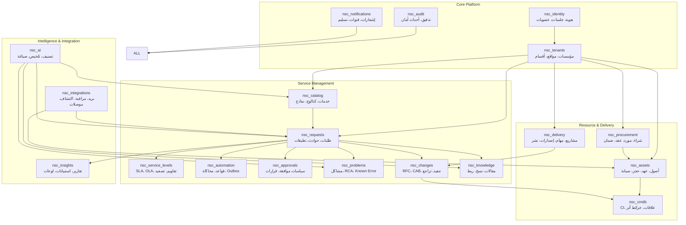

# DOC-04: نموذج المجال — NexusServiceCloud

---

| **معرّف الوثيقة** | DOC-04 |
|-------------------|--------|
| **العنوان** | نموذج المجال: السياقات المحددة، التجميعات، الكيانات، كائنات القيمة، الأحداث |
| **الإصدار** | 1.0.0 |
| **الحالة** | ✓ معتمد |
| **المالك** | هندسة المجال / معمارية الحل |
| **تاريخ التحديث** | 2026-11-09 |
| **التصنيف** | داخلي — سري |
| **الوثائق ذات الصلة** | [DOC-02 تحليل الأعمال](../00-overview/02-business-analysis.md)، [DOC-03 المتطلبات](../00-overview/03-requirements-specification.md)، [DOC-05 هندسة التطبيق](../00-overview/05-application-architecture.md)، [DOC-07 تصميم API](../00-overview/07-api-design.md)، [DOC-14 هجرة البيانات](../00-overview/14-data-migration-seed.md)، [DOC-18 الملاحق](../00-overview/18-appendices.md) |
| **التتبع** | ENT-###، AGG-###، VO-###، EVT-###، IEV-###، CAP-010..160، REQ-FN-001..024 |

---

## 1. ملخص تنفيذي

تحدد هذه الوثيقة **نموذج المجال** (Domain Model) لمنصة NexusServiceCloud باستخدام **التصميم الموجه بالمجال** (Domain-Driven Design - DDD). يتكون النموذج من **19 سياقًا محددًا** (Bounded Contexts) تتوافق مع وحدات Django، كل منها يحتوي على **تجميعات** (Aggregates) تضمن اتساق المعاملات، **كيانات** (Entities) ذات هوية مستمرة، **كائنات قيمة** (Value Objects) غير قابلة للتغيير، **أحداث مجال** (Domain Events) للتواصل داخل السياق، و**أحداث تكامل** (Integration Events) للتواصل بين السياقات.

جميع الكيانات التشغيلية تحمل `tenant_id` لضمان العزل، وتستخدم `version` للتحكم المتفائل في التزامن، و`created_at/updated_at` بالـ UTC مع `timezone` مسمى للعرض.

---

## 2. مبادئ نمذجة المجال

| المبدأ | الوصف |
|---------|--------|
| **عزل المستأجر المطلق** | كل تجميع/كيان تشغيلي ينتمي لمؤسسة واحدة؛ `tenant_id` مفتاح تقسيم فيزيائي (مخطط) ومنطقي (RLS) |
| **هوية غير قابلة للتغيير** | المعرفات (UUIDv7) تُنشأ مرة واحدة ولا تتغير؛ مفاتيح بديلة طبيعية (asset_tag، ticket_number) فريدة داخل المؤسسة |
| **التزامن المتفائل** | حقل `version` (integer) على كل تجميع؛ رفض تحديث عند تعارض (409) |
| **أحداث داخل المعاملة** | أحداث المجال تُسجل في جدول `outbox_events` داخل نفس معاملة الأعمال (Outbox Pattern) |
| **عدم تكرار الأحداث** | مستهلكو أحداث التكامل يستخدمون `InboxReceipt` بمفتاح فريد (`event_id` + `consumer_id`) |
| **كائنات قيمة للمفاهيم المشتركة** | المفاهيم المشتركة (Money، Address، Duration، Percentage) نموذجها كـ VO قابلة لإعادة الاستخدام |
| **أسماء صريحة للأحداث** | صيغة الماضي: `RequestCreated`، `AssetAssigned`، `ChangeApproved` |

---

## 3. خريطة السياقات المحددة (Bounded Context Map)

### 3.1 مسؤوليات السياقات (Context Responsibilities)

| السياق | الرمز | المسؤولية الأساسية | التجميعات الرئيسية |
|--------|------|---------------------|-------------------|
| **الهوية** | IDNT | مصادقة، جلسات، عضويات، تفويض JIT | `UserSession`، `Membership`، `RoleGrant` |
| **المؤسسات** | TENT | دورة حياة المستأجر، هيكل تنظيمي، تقاويم | `Tenant`، `Site`، `Department`، `ServiceDesk`، `SupportGroup` |
| **الكتالوج** | CATL | خدمات، عناصر كتالوج، نماذج، جمهور، سياسات | `Service`، `CatalogItem`، `FormVersion`، `ApprovalPolicy` |
| **الطلبات** | REQS | دورة حياة طلب/حادث، تصنيف، تعيين، تعاون | `Request`، `RequestTransition`، `Comment`، `Attachment`، `WorkLog` |
| **مستوى الخدمة** | SVCL | سياسات SLA/OLA، نسخ، مقاطع ساعة، تصعيد | `SLAPolicyVersion`، `SLAInstance`، `ClockSegment`، `EscalationExecution`، `OLASegment` |
| **الأتمتة** | AUTO | قواعد، محاكاة، تنفيذ، سجل تشغيل | `AutomationRule`، `AutomationExecution`، `OutboxEvent` |
| **الموافقات** | APPR | موافقات خطية/متقدمة، خطوات، نصاب، تفويض | `ApprovalInstance`، `ApprovalStep`، `ApprovalDecision` |
| **المشكلات** | PROB | RCA، حل مؤقت، خطأ معروف، ربط حوادث | `Problem`، `ProblemIncident`، `KnownError` |
| **التغييرات** | CHNG | RFC، أنواع، أثر، مخاطر، CAB، تنفيذ، تراجع | `Change`، `ChangeCI`، `ChangeTask`، `DeploymentAttempt` |
| **المعرفة** | KNOW | مقالات، نسخ، مراجعة، جمهور، ربط بالتذكرة | `KnowledgeArticle`، `KnowledgeRevision`، `RequestKnowledgeLink` |
| **الأصول** | ASST | أصل، Tag، Serial، حالة، موقع، مالك، حائز، ضمان | `Asset`، `AssetAssignment`، `Reservation`، `MaintenanceOccurrence` |
| **CMDB** | CMDB | CI، علاقات، خرائط أثر، مصدر | `ConfigurationItem`، `CIRelation`، `AssetCILink` |
| **المشتريات** | PROC | طلب شراء، بنود، مورد، استلام، عقد، ضمان | `PurchaseOrder`، `PurchaseLine`، `Receipt`، `Contract`، `ContractAsset` |
| **التسليم** | DLVR | مشاريع، مهام، تبعيات، مراحل، إصدارات، نشر | `Project`، `Task`، `TaskDependency`، `Release`، `ReleaseChange` |
| **التكاملات** | INTG | موصلات، خرائط حقول، مزامنة، صحة، تسوية | `Connector`، `FieldMapping`، `SyncJob`، `ReconciliationResult` |
| **الذكاء الاصطناعي** | AIML | اقتراحات، قرارات بشرية، تعلم، قابل للتعطيل | `AIRecommendation`، `AIFeedback`، `AIModelVersion` |
| **الرؤى** | INSG | تقارير، استبيانات، لوحات، مؤشرات | `Report`، `Survey`، `SurveyResponse`، `Dashboard` |
| **التدقيق** | AUDT | أحداث أعمال، محاولات رفض، قناة مراقبة مستقلة | `AuditEvent`، `SecurityEvent` |
| **الإشعارات** | NOTF | قنوات، قوالب، محاولات، تسليم، تفضيلات | `NotificationTemplate`، `NotificationDelivery`، `NotificationPreference` |

---

## 4. تفصيل كل سياق محدد

### 4.1 سياق الهوية (IDNT - nsc_identity)

#### التجميع: `UserSession` (AGG-IDNT-001)
**الجذر:** `UserSession` — جلسة مستخدم نشطة مع ادعاءات JWT
**الكيانات:**
- `UserSession` (ENT-IDNT-001): `session_id` (PK)، `user_id`، `tenant_id`، `issued_at`، `expires_at`، `refresh_token_hash`، `mfa_verified`، `ip_address`، `user_agent`، `status` (active/revoked/expired)
- `Membership` (ENT-IDNT-002): `membership_id` (PK)، `user_id`، `tenant_id`، `status` (active/suspended/pending)، `roles` (JSON array)، `groups` (JSON array)، `granted_at`، `revoked_at`، `version`

**كائنات القيمة:**
- `JWTClaims` (VO-IDNT-001): `sub`، `tenant_id`، `roles[]`، `groups[]`، `permissions[]`، `session_id`، `exp`، `iat`
- `MFAChallenge` (VO-IDNT-002): `challenge_type` (totp/webauthn/push)، `challenge_id`، `created_at`، `expires_at`

**أحداث المجال:**
- `UserAuthenticated` (EVT-IDNT-001): `user_id`، `tenant_id`، `session_id`، `mfa_used`، `ip`
- `SessionRevoked` (EVT-IDNT-002): `session_id`، `reason` (logout/suspend/admin_revoke/expired)
- `MembershipGranted` (EVT-IDNT-003): `user_id`، `tenant_id`، `roles`، `groups`، `granted_by`
- `MembershipRevoked` (EVT-IDNT-004): `user_id`، `tenant_id`، `reason`، `revoked_by`

**أحداث التكامل:**
- `UserProvisionedViaSCIM` (IEV-IDNT-001): `user_id`، `tenant_id`، `external_id`، `attributes`
- `UserDeprovisionedViaSCIM` (IEV-IDNT-002): `user_id`، `tenant_id`، `external_id`

**قواعد الثابتة (Invariants):**
- جلسة واحدة نشطة لكل `refresh_token_hash`
- إلغاء العضوية يبطل جميع جلسات المستخدم في تلك المؤسسة فورًا
- `version` على `Membership` يمنع التحديث المتزامن للأدوار/المجموعات

---

### 4.2 سياق المؤسسات (TENT - nsc_tenants)

#### التجميع: `Tenant` (AGG-TENT-001)
**الجذر:** `Tenant` — مؤسسة مستقلة مع عزل فيزيائي/منطقي
**الكيانات:**
- `Tenant` (ENT-TENT-001): `tenant_id` (PK)، `name`، `slug`، `status` (active/trial/suspended/archived)، `deployment_pattern` (cloud/onprem/hybrid)، `default_timezone`، `created_at`، `trial_ends_at`، `version`
- `Site` (ENT-TENT-002): `site_id` (PK)، `tenant_id`، `name`، `address`، `timezone`، `working_calendar_id`، `status`، `version`
- `Department` (ENT-TENT-003): `department_id` (PK)، `tenant_id`، `name`، `parent_department_id` (Nullable)، `manager_user_id`، `status`، `version`
- `ServiceDesk` (ENT-TENT-004): `service_desk_id` (PK)، `tenant_id`، `name`، `description`، `visibility_policy` (public/restricted/department_group)، `default_group_id`، `status`، `version`
- `SupportGroup` (ENT-TENT-005): `group_id` (PK)، `tenant_id`، `name`، `service_desk_id`، `escalation_policy_id`، `working_calendar_id`، `status`، `version`
- `GroupMembership` (ENT-TENT-006): `group_membership_id` (PK)، `group_id`، `user_id`، `role_in_group` (member/lead/manager)، `status`، `version`
- `WorkingCalendar` (ENT-TENT-007): `calendar_id` (PK)، `tenant_id`، `name`، `timezone`، `rules` (JSON: فترات عمل، عطلات، استثناءات)، `version`

**كائنات القيمة:**
- `Address` (VO-TENT-001): `street`، `city`، `state`، `postal_code`، `country`، `coordinates` (lat/lng)
- `CalendarRule` (VO-TENT-002): `type` (working_hours/holiday/exception)، `start`، `end`، `recurrence` (RRULE)، `timezone`

**أحداث المجال:**
- `TenantCreated` (EVT-TENT-001): `tenant_id`، `name`، `deployment_pattern`
- `SiteCreated` (EVT-TENT-002): `site_id`، `tenant_id`، `name`، `timezone`
- `DepartmentCreated` (EVT-TENT-003): `department_id`، `tenant_id`، `name`، `parent_id`
- `ServiceDeskCreated` (EVT-TENT-004): `service_desk_id`، `tenant_id`، `name`، `visibility_policy`
- `SupportGroupCreated` (EVT-TENT-005): `group_id`، `tenant_id`، `name`، `service_desk_id`

**أحداث التكامل:**
- `TenantProvisioned` (IEV-TENT-001): `tenant_id`، `schema_name`، `admin_user_id`، `region`
- `TenantSuspended` (IEV-TENT-002): `tenant_id`، `reason`

**قواعد الثابتة:**
- `slug` فريد عالميًا؛ `name` فريد داخل المؤسسة
- تعطيل `Site`/`Department`/`ServiceDesk`/`SupportGroup` لا يحذف التاريخ (soft status)
- `WorkingCalendar` مرجع لحسابات SLA؛ لا يُحذف إذا مستخدم

---

### 4.3 سياق الكتالوج (CATL - nsc_catalog)

#### التجميع: `Service` (AGG-CATL-001)
**الجذر:** `Service` — خدمة أعمال مقدمة للمستفيدين
**الكيانات:**
- `Service` (ENT-CATL-001): `service_id` (PK)، `tenant_id`، `owner_user_id`، `name`، `description`، `status` (active/retired/draft)، `version`
- `CatalogItem` (ENT-CATL-002): `catalog_item_id` (PK)، `service_id`، `name`، `description`، `audience` (JSON: roles/groups/departments)، `form_version_id`، `approval_policy_id`، `fulfillment_type` (manual/automated/hybrid)، `status` (published/hidden/archived)، `version`
- `FormVersion` (ENT-CATL-003): `form_version_id` (PK)، `catalog_item_id`، `schema` (JSON Schema Draft 2020-12)، `ui_schema` (JSON)، `created_by`، `created_at`، `status` (draft/active/deprecated)، `version`
- `ApprovalPolicy` (ENT-CATL-004): `policy_id` (PK)، `tenant_id`، `name`، `type` (simple/advanced)، `steps` (JSON array of steps)، `sod_rules` (JSON)، `version`

**كائنات القيمة:**
- `AudienceSpec` (VO-CATL-001): `include_roles[]`، `include_groups[]`، `include_departments[]`، `exclude_roles[]`...
- `FormField` (VO-CATL-002): `field_id`، `label`، `type` (text/number/date/select/multi_select/user_picker/asset_picker/ci_picker)، `required`، `default`، `validation`، `visibility_condition` (JSONLogic)، `protected` (boolean)

**أحداث المجال:**
- `ServiceCreated` (EVT-CATL-001): `service_id`، `tenant_id`، `owner_user_id`
- `CatalogItemPublished` (EVT-CATL-002): `catalog_item_id`، `service_id`، `form_version_id`، `audience`
- `FormVersionActivated` (EVT-CATL-003): `form_version_id`، `catalog_item_id`، `schema_hash`
- `ApprovalPolicyUpdated` (EVT-CATL-004): `policy_id`، `tenant_id`، `version`

**أحداث التكامل:**
- `CatalogItemPublishedForPortal` (IEV-CATL-001): `catalog_item_id`، `service_id`، `form_version_id`، `portal_audience`

**قواعد الثابتة:**
- `CatalogItem` لا يُنشر بدون `FormVersion` نشط
- تعطيل عنصر كتالوج (`status=hidden`) يمنع طلبات جديدة ويحفظ الطلبات الجارية
- `FormVersion` ثابت للطلب الجاري (ثبات العقد)

---

### 4.4 سياق الطلبات (REQS - nsc_requests)

#### التجميع: `Request` (AGG-REQS-001) — **التجميع المركزي**
**الجذر:** `Request` — طلب خدمة أو حادث
**الكيانات:**
- `Request` (ENT-REQS-001): `request_id` (PK)، `tenant_id`، `ticket_number` (Unique per tenant)، `type` (incident/service_request)، `source` (portal/email/phone/chat/monitoring/ai)، `title`، `description`، `requester_user_id`، `service_desk_id`، `service_id`، `catalog_item_id` (Nullable)، `form_version_id` (Nullable)، `classification_category_id`، `classification_subcategory_id`، `classification_item_id`، `impact` (1..5)، `urgency` (1..5)، `priority` (محسوب: impact+urgency matrix)، `status` (new/triaged/assigned/in_progress/pending/on_hold/resolved/closed/reopened/cancelled)، `group_id`، `technician_user_id`، `sla_instance_id` (Nullable)، `resolved_at`، `closed_at`، `created_at`، `updated_at`، `version`
- `RequestFieldValue` (ENT-REQS-002): `field_value_id` (PK)، `request_id`، `field_id`، `value` (JSON)، `version`
- `RequestTransition` (ENT-REQS-003): `transition_id` (PK)، `request_id`، `from_status`، `to_status`، `reason`، `actor_user_id`، `expected_version`، `actual_version`، `timestamp`، `metadata` (JSON)
- `Comment` (ENT-REQS-004): `comment_id` (PK)، `request_id`، `author_user_id`، `visibility` (public/internal)، `text`، `edited_at` (Nullable)، `edited_by` (Nullable)، `version`
- `Attachment` (ENT-REQS-005): `attachment_id` (PK)، `parent_type` (request/comment/worklog/knowledge)، `parent_id`، `storage_key`، `filename`، `content_type`، `size_bytes`، `checksum_sha256`، `scan_status` (pending/clean/infected/quarantined)، `scan_result` (JSON)، `version`
- `WorkLog` (ENT-REQS-006): `worklog_id` (PK)، `request_id`، `technician_user_id`، `duration_seconds` (Positive)، `work_date`، `description`، `correction_reason` (Nullable)، `corrected_at` (Nullable)، `corrected_by` (Nullable)، `version`

**كائنات القيمة:**
- `PriorityMatrix` (VO-REQS-001): `impact`، `urgency` → `priority` (1=Critical .. 5=Low)
- `ClassificationPath` (VO-REQS-002): `category_id`، `subcategory_id`، `item_id`
- `SLAReference` (VO-REQS-003): `sla_instance_id`، `response_target`، `resolution_target`، `calendar_id`

**أحداث المجال:**
- `RequestCreated` (EVT-REQS-001): `request_id`، `tenant_id`، `type`، `ticket_number`، `requester_id`، `service_desk_id`، `priority`، `classification`
- `RequestAssigned` (EVT-REQS-002): `request_id`، `group_id`، `technician_user_id`، `assigned_by`، `assignment_rule_id` (Nullable)
- `RequestStatusChanged` (EVT-REQS-003): `request_id`، `from_status`، `to_status`، `actor_user_id`، `reason`، `timestamp`
- `RequestResolved` (EVT-REQS-004): `request_id`، `resolution_summary`، `resolution_category`، `technician_user_id`، `knowledge_link_id` (Nullable)
- `RequestClosed` (EVT-REQS-005): `request_id`، `closed_by`، `closure_code`، `requester_confirmed` (boolean)
- `RequestReopened` (EVT-REQS-006): `request_id`، `reopened_by`، `reason`، `previous_closed_at`
- `CommentAdded` (EVT-REQS-007): `comment_id`، `request_id`، `author_user_id`، `visibility`
- `AttachmentUploaded` (EVT-REQS-008): `attachment_id`، `parent_type`، `parent_id`، `scan_status`
- `WorkLogRecorded` (EVT-REQS-009): `worklog_id`، `request_id`، `technician_user_id`، `duration_seconds`، `work_date`

**أحداث التكامل:**
- `IncidentCreatedFromMonitoring` (IEV-REQS-001): `request_id`، `monitoring_event_id`، `alert_details`
- `RequestCreatedFromEmail` (IEV-REQS-002): `request_id`، `email_message_id`، `sender`، `subject`
- `RequestSLAUpdated` (IEV-REQS-003): `request_id`، `sla_instance_id`، `response_target`، `resolution_target`

**قواعد الثابتة:**
- رقم التذكرة (`ticket_number`) فريد داخل المؤسسة فقط
- انتقالات الحالة محكومة بمصفوفة انتقال صريحة لكل نوع طلب
- إغلاق يتطلب `resolution_summary` غير فارغ
- تحديث متزامن يرفض عند `version` غير متطابق (409)
- ملاحظة داخلية (`visibility=internal`) لا تخرج للمستفيد بأي قناة
- مرفق في حالة `quarantined` غير قابل للتنزيل

---

### 4.5 سياق مستوى الخدمة (SVCL - nsc_service_levels)

#### التجميع: `SLAPolicyVersion` (AGG-SVCL-001)
**الجذر:** `SLAPolicyVersion` — نسخة غير قابلة للتغيير من سياسة SLA
**الكيانات:**
- `SLAPolicyVersion` (ENT-SVCL-001): `policy_version_id` (PK)، `tenant_id`، `name`، `match_conditions` (JSON: قواعد مطابقة الطلب)، `priority_order` (integer)، `response_target_seconds`، `resolution_target_seconds`، `pause_rules` (JSON: شروط إيقاف الساعة)، `calendar_id`، `escalation_levels` (JSON array)، `created_by`، `created_at`، `status` (active/archived)
- `SLAInstance` (ENT-SVCL-002): `instance_id` (PK)، `request_id`، `policy_version_id`، `response_target_at`، `resolution_target_at`، `response_status` (met/breached/paused/pending)، `resolution_status`، `response_breached_at`، `resolution_breached_at`، `total_paused_seconds`، `version`
- `ClockSegment` (ENT-SVCL-003): `segment_id` (PK)، `instance_id`، `metric` (response/resolution)، `start_at`، `end_at` (Nullable)، `segment_type` (active/paused)، `pause_reason`، `version`
- `EscalationExecution` (ENT-SVCL-004): `execution_id` (PK)، `instance_id`، `metric`، `cycle`، `level`، `action` (notify/reassign/upgrade_priority/custom)، `executed_at`، `details` (JSON) — **Unique constraint على (instance_id, metric, cycle, level)**
- `OLASegment` (ENT-SVCL-005): `segment_id` (PK)، `request_id`، `group_id`، `assigned_at`، `reassigned_at` (Nullable)، `budget_seconds`، `consumed_seconds`، `version`

**كائنات القيمة:**
- `EscalationAction` (VO-SVCL-001): `type`، `target_user_id`، `target_group_id`، `priority_upgrade`، `custom_webhook_url`
- `PauseCondition` (VO-SVCL-002): `condition_type` (waiting_customer/waiting_vendor/scheduled_maintenance/custom)، `criteria` (JSONLogic)

**أحداث المجال:**
- `SLAInstanceStarted` (EVT-SVCL-001): `instance_id`، `request_id`، `policy_version_id`، `response_target_at`، `resolution_target_at`
- `SLAClockPaused` (EVT-SVCL-002): `instance_id`، `metric`، `segment_id`، `reason`
- `SLAClockResumed` (EVT-SVCL-003): `instance_id`، `metric`، `segment_id`، `paused_duration_seconds`
- `SLAEscalationExecuted` (EVT-SVCL-004): `execution_id`، `instance_id`، `metric`، `level`، `action`
- `SLAResponseBreached` (EVT-SVCL-005): `instance_id`، `breached_at`، `target_at`
- `SLAResolutionBreached` (EVT-SVCL-006): `instance_id`، `breached_at`، `target_at`
- `OLASegmentStarted` (EVT-SVCL-007): `segment_id`، `request_id`، `group_id`، `budget_seconds`
- `OLASegmentEnded` (EVT-SVCL-008): `segment_id`، `consumed_seconds`، `reassigned_to_group_id` (Nullable)

**أحداث التكامل:**
- `SLABreachAlert` (IEV-SVCL-001): `instance_id`، `metric`، `breach_type`، `escalation_level`، `recipients`

**قواعد الثابتة:**
- `EscalationExecution` فريد على `(instance_id, metric, cycle, level)` يمنع تكرار التصعيد
- `ClockSegment` لا يسمح بتداخل مقاطع لنفس المetric
- هدف SLA جزء من النسخة المثبتة (`SLAInstance`) وليس رقمًا يعاد أخذه من سياسة حية
- إعادة فتح طلب تعيد حساب `SLAInstance` جديد مع أهداف محدثة؛ لا يعيد تصعيدًا منفذًا مسبقًا

---

### 4.6 سياق الأتمتة (AUTO - nsc_automation)

#### التجميع: `AutomationRule` (AGG-AUTO-001)
**الجذر:** `AutomationRule` — قاعدة أتمتة ذات إصدار
**الكيانات:**
- `AutomationRule` (ENT-AUTO-001): `rule_id` (PK)، `tenant_id`، `name`، `description`، `trigger_event` (request_created/status_changed/comment_added/attachment_uploaded/worklog_recorded/sla_breach/scheduled/time_based/custom)، `conditions` (JSONLogic)، `actions` (JSON array مرتب: set_field/add_comment/send_notification/create_task/assign/run_webhook/call_ai/create_problem/create_change)، `version`، `enabled`، `dry_run_only`، `max_execution_depth` (default 10)، `created_by`، `created_at`، `updated_at`
- `AutomationExecution` (ENT-AUTO-002): `execution_id` (PK)، `rule_id`، `rule_version`، `trigger_event_id`، `trigger_payload` (JSON)، `status` (pending/running/succeeded/failed/skipped/dry_run)، `started_at`، `completed_at`، `actions_executed` (JSON array)، `decision_trace` (JSON: كل فعل مع شرط/نتيجة/خطأ)، `error` (Nullable)

**كائنات القيمة:**
- `AutomationAction` (VO-AUTO-001): `action_type`، `parameters` (JSON)، `order`، `continue_on_failure` (boolean)
- `ExecutionContext` (VO-AUTO-002): `request_id`، `tenant_id`، `actor_user_id` (system for automation)، `correlation_id`

**أحداث المجال:**
- `AutomationRuleCreated` (EVT-AUTO-001): `rule_id`، `tenant_id`، `trigger_event`، `version`
- `AutomationExecutionStarted` (EVT-AUTO-002): `execution_id`، `rule_id`، `rule_version`، `trigger_event_id`
- `AutomationActionExecuted` (EVT-AUTO-003): `execution_id`، `action_index`، `action_type`، `result` (success/failed/skipped)، `output`
- `AutomationExecutionCompleted` (EVT-AUTO-004): `execution_id`، `status`، `total_actions`، `failed_actions`، `duration_ms`

**أحداث التكامل:**
- `AutomationWebhookCalled` (IEV-AUTO-001): `execution_id`، `action_index`، `webhook_url`، `payload`، `response_status`، `response_body`

**قواعد الثابتة:**
- `max_execution_depth` يمنع تسلسل قواعد غير محدود (افتراضي 10)
- فشل إجراء خارجي (بريد، Webhook) لا يتراجع عن معاملة الأعمال (Outbox Pattern)
- `InboxReceipt` يمنع إعادة تنفيذ نفس الحدث لنفس القاعدة
- `dry_run_only=true` ينفذ محاكاة فقط دون آثار جانبية

---

### 4.7 سياق الموافقات (APPR - nsc_approvals)

#### التجميع: `ApprovalInstance` (AGG-APPR-001)
**الجذر:** `ApprovalInstance` — مثيل موافقة لمورد محدد
**الكيانات:**
- `ApprovalInstance` (ENT-APPR-001): `instance_id` (PK)، `tenant_id`، `resource_type` (request/change/asset/purchase/kb_article)، `resource_id`، `resource_version`، `policy_id`، `policy_version`، `status` (pending/approved/rejected/cancelled/expired)، `initiator_user_id`، `created_at`، `decided_at` (Nullable)، `version`
- `ApprovalStep` (ENT-APPR-002): `step_id` (PK)، `instance_id`، `step_order`، `step_type` (sequential/parallel)، `quorum` (integer: عدد مطلوب للاعتماد)، `approvers` (JSON array: user_id/group_id/role)، `timeout_seconds` (Nullable)، `escalation_policy_id` (Nullable)
- `ApprovalDecision` (ENT-APPR-003): `decision_id` (PK)، `instance_id`، `step_id`، `approver_user_id`، `decision` (approve/reject/delegate)، `reason`، `delegated_to_user_id` (Nullable)، `delegation_expires_at` (Nullable)، `decided_at`، `version`

**كائنات القيمة:**
- `ApproverSpec` (VO-APPR-001): `type` (user/group/role)، `identifier`، `delegation_allowed` (boolean)، `max_delegation_days` (integer)

**أحداث المجال:**
- `ApprovalInstanceCreated` (EVT-APPR-001): `instance_id`، `tenant_id`، `resource_type`، `resource_id`، `policy_id`، `initiator_user_id`
- `ApprovalDecisionMade` (EVT-APPR-002): `decision_id`، `instance_id`، `step_id`، `approver_user_id`، `decision`، `delegated_to_user_id` (Nullable)
- `ApprovalInstanceCompleted` (EVT-APPR-003): `instance_id`، `final_status` (approved/rejected)، `decided_at`
- `ApprovalRevoked` (EVT-APPR-004): `instance_id`، `reason` (resource_changed/sod_violation/admin_cancel)

**أحداث التكامل:**
- `ApprovalRequiredNotification` (IEV-APPR-001): `instance_id`، `step_id`، `approvers`، `resource_type`، `resource_id`، `due_at`
- `ApprovalEscalationTriggered` (IEV-APPR-002): `instance_id`، `step_id`، `escalation_level`، `recipients`

**قواعد الثابتة:**
- مقدم الطلب (`initiator_user_id`) لا يمكن أن يكون موافقًا إذا فرضت السياسة SoD
- تغيير `resource_version` (محتوى مؤثر) يبطل `ApprovalInstance` الحالي وينشئ جديدًا
- تفويض (`delegation`) محدد المدة (`delegation_expires_at`) ويسجل في `ApprovalDecision`

---

### 4.8 سياق المشكلات (PROB - nsc_problems)

#### التجميع: `Problem` (AGG-PROB-001)
**الجذر:** `Problem` — تحقيق سبب جذري
**الكيانات:**
- `Problem` (ENT-PROB-001): `problem_id` (PK)، `tenant_id`، `title`، `description`، `symptoms`، `root_cause` (Nullable)، `workaround` (Nullable)، `known_error` (Nullable)، `status` (investigating/known_error/closed)، `owner_user_id`، `created_at`، `updated_at`، `closed_at` (Nullable)، `closure_reason` (Nullable)، `version`
- `ProblemIncident` (ENT-PROB-002): `link_id` (PK)، `problem_id`، `request_id`، `linked_at`، `linked_by` — **يحفظ رقم وتاريخ الحادث وقت الربط**
- `KnownError` (ENT-PROB-003): `known_error_id` (PK)، `problem_id`، `title`، `cause`، `workaround`، `status` (open/closed)، `created_at`، `updated_at`

**أحداث المجال:**
- `ProblemCreated` (EVT-PROB-001): `problem_id`، `tenant_id`، `owner_user_id`، `linked_incident_ids[]`
- `IncidentLinkedToProblem` (EVT-PROB-002): `problem_id`، `request_id`، `linked_by`
- `ProblemRootCauseIdentified` (EVT-PROB-003): `problem_id`، `root_cause`، `identified_by`
- `KnownErrorCreated` (EVT-PROB-004): `known_error_id`، `problem_id`، `title`، `cause`، `workaround`
- `ProblemClosed` (EVT-PROB-005): `problem_id`، `closure_reason`، `closed_by` — **يتطلب تفسير النتيجة**

**أحداث التكامل:**
- `ProblemLinkedToChange` (IEV-PROB-001): `problem_id`، `change_id`، `link_type` (permanent_fix/workaround)

**قواعد الثابتة:**
- ربط حوادث لا يحولها أو يحذفها؛ `ProblemIncident` يحفظ `request_id` و `linked_at`
- إغلاق مشكلة يتطلب `closure_reason`؛ لا تغلق الحوادث تلقائيًا
- خطأ معروف (`KnownError`) ينشأ من مشكلة ويمكن ربطه بحلول دائمة

---

### 4.9 سياق التغييرات (CHNG - nsc_changes)

#### التجميع: `Change` (AGG-CHNG-001)
**الجذر:** `Change` — طلب تغيير (RFC)
**الكيانات:**
- `Change` (ENT-CHNG-001): `change_id` (PK)، `tenant_id`، `title`، `description`، `reason`، `type` (normal/standard/emergency)، `risk_level` (low/medium/high/critical)، `impact_assessment` (JSON)، `implementation_plan` (JSON)، `rollback_plan` (JSON)، `test_plan` (JSON)، `work_window_start`، `work_window_end`، `approval_instance_id` (Nullable)، `status` (draft/pending_approval/scheduled/implementing/completed/failed/closed/rolled_back)، `owner_user_id`، `created_at`، `updated_at`، `implemented_at` (Nullable)، `closed_at` (Nullable)، `version`
- `ChangeCI` (ENT-CHNG-002): `link_id` (PK)، `change_id`، `ci_id`، `impact_type` (affected/dependent/outage_risk)، `direction` (upstream/downstream/both)
- `ChangeTask` (ENT-CHNG-003): `task_id` (PK)، `change_id`، `title`، `description`، `assignee_user_id`، `order`، `status` (pending/in_progress/completed/failed/skipped)، `started_at`، `completed_at`، `notes`
- `DeploymentAttempt` (ENT-CHNG-004): `attempt_id` (PK)، `change_id`، `environment`، `started_at`، `completed_at` (Nullable)، `status` (success/failed/rolled_back)، `performed_by`، `logs` (JSON)، `rollback_reason` (Nullable)

**أحداث المجال:**
- `ChangeRequested` (EVT-CHNG-001): `change_id`، `tenant_id`، `type`، `risk_level`، `owner_user_id`
- `ChangeApproved` (EVT-CHNG-002): `change_id`، `approval_instance_id`، `approved_by` (CAB/chair)
- `ChangeScheduled` (EVT-CHNG-003): `change_id`، `work_window_start`، `work_window_end`
- `ChangeImplementationStarted` (EVT-CHNG-004): `change_id`، `started_by`
- `ChangeTaskCompleted` (EVT-CHNG-005): `task_id`، `change_id`، `completed_by`
- `ChangeImplemented` (EVT-CHNG-006): `change_id`، `implemented_by`، `deployment_attempt_id`
- `ChangeFailed` (EVT-CHNG-007): `change_id`، `failure_reason`، `rollback_initiated` (boolean)
- `ChangeRolledBack` (EVT-CHNG-008): `change_id`، `rolled_back_by`، `reason`
- `ChangePIRCompleted` (EVT-CHNG-009): `change_id`، `pir_outcome` (successful/partial/failed)، `lessons_learned`

**أحداث التكامل:**
- `ChangeCImpactAssessed` (IEV-CHNG-001): `change_id`، `affected_cis[]`، `impact_map`
- `ChangeDeploymentTriggered` (IEV-CHNG-002): `change_id`، `deployment_attempt_id`، `environment`، `artifacts`

**قواعد الثابتة:**
- تغيير عادي (`normal`) لا يبدأ بدون `approval_instance` مكتمل + `implementation_plan` + `rollback_plan`
- تغيير قياسي (`standard`) يتبع قالبًا معتمدًا (`StandardChangeTemplate`)
- تغيير طارئ (`emergency`) يسجل `emergency_authorization` مع مراجعة لاحقة إلزامية (PIR)
- `DeploymentAttempt` يوثق البيئة، النتيجة، والتراجع؛ الإصدار قد ينشر أكثر من مرة

---

### 4.10 سياق المعرفة (KNOW - nsc_knowledge)

#### التجميع: `KnowledgeArticle` (AGG-KNOW-001)
**الجذر:** `KnowledgeArticle` — مقال معرفة مع إدارة نسخ
**الكيانات:**
- `KnowledgeArticle` (ENT-KNOW-001): `article_id` (PK)، `tenant_id`، `title`، `current_revision_id` (Nullable)، `status` (draft/published/archived)، `audience` (public/internal/restricted)، `owner_user_id`، `created_at`، `updated_at`، `version`
- `KnowledgeRevision` (ENT-KNOW-002): `revision_id` (PK)، `article_id`، `content` (HTML/Markdown)، `summary`، `author_user_id`، `status` (draft/review/approved/published)، `reviewed_by` (Nullable)، `reviewed_at` (Nullable)، `published_at` (Nullable)، `created_at`، `version`
- `RequestKnowledgeLink` (ENT-KNOW-003): `link_id` (PK)، `request_id`، `article_id`، `revision_id`، `linked_at`، `linked_by` — **يحفظ نسخة المقال المستخدمة لتفسير الحل تاريخيًا**

**كائنات القيمة:**
- `ArticleContent` (VO-KNOW-001): `html`، `markdown`، `attachments[]` (storage keys)

**أحداث المجال:**
- `KnowledgeArticleCreated` (EVT-KNOW-001): `article_id`، `tenant_id`، `owner_user_id`، `audience`
- `KnowledgeRevisionPublished` (EVT-KNOW-002): `revision_id`، `article_id`، `published_at`، `audience`
- `KnowledgeLinkedToRequest` (EVT-KNOW-003): `link_id`، `request_id`، `article_id`، `revision_id`
- `KnowledgeArticleArchived` (EVT-KNOW-004): `article_id`، `archived_by`

**أحداث التكامل:**
- `KnowledgePublishedForPortal` (IEV-KNOW-001): `article_id`، `revision_id`، `portal_audience`

**قواعد الثابتة:**
- إنشاء مسودة من حل حادث (`create_draft_from_resolution`) ينشئ مقالًا مجهولًا (بدون PII)
- المستفيد لا يبحث في مقال `audience=internal`
- تحديث مقال ينشئ `KnowledgeRevision` جديدة؛ المنشور يشير لأحدث `approved`
- `RequestKnowledgeLink` يحفظ `revision_id` المستخدمة وقت الحل (تتبع تاريخي)

---

### 4.11 سياق الأصول (ASST - nsc_assets)

#### التجميع: `Asset` (AGG-ASST-001)
**الجذر:** `Asset` — أصل تقني مع دورة حياة كاملة
**الكيانات:**
- `Asset` (ENT-ASST-001): `asset_id` (PK)، `tenant_id`، `asset_tag` (Unique per tenant)، `serial_number` (Nullable)، `asset_type_id`، `asset_category_id`، `asset_status_id`، `manufacturer`، `model`، `location_id`، `owner_user_id` (Nullable)، `custodian_user_id` (Nullable)، `supplier_id` (Nullable)، `purchase_date` (Nullable)، `warranty_expires_at` (Nullable)، `cost_center` (Nullable)، `cost_amount` (Nullable)، `currency` (Nullable)، `depreciation_method` (Nullable)، `depreciation_start` (Nullable)، `disposed_at` (Nullable)، `disposal_reason` (Nullable)، `created_at`، `updated_at`، `version`
- `AssetAssignment` (ENT-ASST-002): `assignment_id` (PK)، `asset_id`، `custodian_user_id`، `start_date`، `end_date` (Nullable)، `delivery_proof` (JSON: الموقع، المستلم، التوقيع، الصور)، `status` (active/returned/transferred)، `version`
- `Reservation` (ENT-ASST-003): `reservation_id` (PK)، `asset_id`، `requester_user_id`، `start_at`، `end_at`، `status` (requested/confirmed/active/completed/cancelled/expired)، `purpose`، `version` — **Unique constraint على (asset_id, status IN (confirmed,active), daterange overlap) يمنع تداخل ذري**
- `MaintenanceOccurrence` (ENT-ASST-004): `occurrence_id` (PK)، `asset_id` (Nullable)، `asset_group_id` (Nullable)، `plan_id`، `scheduled_at`، `started_at` (Nullable)، `completed_at` (Nullable)، `status` (scheduled/in_progress/completed/missed/cancelled)، `performed_by_user_id` (Nullable)، `result` (JSON)، `missed_reason` (Nullable)، `cost` (Nullable) — **Unique على (plan_id, scheduled_at)**
- `AssetCustomFieldValue` (ENT-ASST-005): `field_value_id` (PK)، `asset_id`، `field_id`، `value` (JSON)

**كائنات القيمة:**
- `AssetIdentifier` (VO-ASST-001): `asset_tag`، `serial_number`
- `WarrantyInfo` (VO-ASST-002): `provider`، `start_date`، `end_date`، `coverage_type`، `contract_reference`

**أحداث المجال:**
- `AssetCreated` (EVT-ASST-001): `asset_id`، `tenant_id`، `asset_tag`، `asset_type_id`، `serial_number`
- `AssetAssigned` (EVT-ASST-002): `assignment_id`، `asset_id`، `custodian_user_id`، `start_date`، `delivery_proof`
- `AssetReturned` (EVT-ASST-003): `assignment_id`، `asset_id`، `returned_by`، `end_date`، `condition_notes`
- `AssetTransferred` (EVT-ASST-004): `asset_id`، `from_user_id`، `to_user_id`، `transfer_date`، `reason`
- `AssetReserved` (EVT-ASST-005): `reservation_id`، `asset_id`، `requester_user_id`، `start_at`، `end_at`
- `AssetMaintenanceCompleted` (EVT-ASST-006): `occurrence_id`، `asset_id`، `result`، `cost`، `next_scheduled_at` (Nullable)
- `AssetDisposed` (EVT-ASST-007): `asset_id`، `disposal_reason`، `disposed_by`، `disposed_at`
- `AssetRetired` (EVT-ASST-008): `asset_id`، `retired_by`، `retired_at` — **لا يمحو سجلات حوادث سابقة**

**أحداث التكامل:**
- `AssetDiscoveredFromIntegration` (IEV-ASST-001): `asset_id` (Nullable)، `source_connector_id`، `external_id`، `raw_data`، `reconciliation_action` (create/update/conflict)
- `AssetReconciled` (IEV-ASST-002): `asset_id`، `source_connector_id`، `field_changes` (JSON)، `conflicts_resolved` (JSON)

**قواعد الثابتة:**
- `asset_tag` فريد داخل المؤسسة؛ `serial_number` اختياري ولا يعتمد عليه للكشف عن الهوية
- تسليم أصل محجوز لشخص آخر يفشل ذريًا (معاملة واحدة)
- حجزين مؤكدين متداخلين لنفس الأصل ممنوعان (قيد استبعاد على daterange)
- خطة صيانة تنتج `MaintenanceOccurrence` واحدًا لكل موعد مع مفتاح فريد
- تقاعد أصل لا يمحو سجلات طلبات/حوادث سابقة

---

### 4.12 سياق CMDB (CMDB - nsc_cmdb)

#### التجميع: `ConfigurationItem` (AGG-CMDB-001)
**الجذر:** `ConfigurationItem` — عنصر تكوين مع علاقات
**الكيانات:**
- `ConfigurationItem` (ENT-CMDB-001): `ci_id` (PK)، `tenant_id`، `ci_type_id`، `name`، `status`، `service_id` (Nullable)، `source` (manual/discovery/integration)، `external_id` (Nullable)، `attributes` (JSON: مواصفات فنية)، `version`
- `CIRelation` (ENT-CMDB-002): `relation_id` (PK)، `source_ci_id`، `target_ci_id`، `relation_type_id`، `direction` (upstream/downstream/bidirectional)، `valid_from`، `valid_to` (Nullable)، `version` — **منع حلقات وفق نوع العلاقة** (وليس لكل أنواع العلاقات عشوائيًا)
- `AssetCILink` (ENT-CMDB-003): `link_id` (PK)، `asset_id`، `ci_id`، `link_purpose` (represents/hosts/depends_on) — **أصل واحد قد يرتبط بتمثيل CI واحد لكل غرض محدد**
- `CIType` (ENT-CMDB-004): `ci_type_id` (PK)، `tenant_id`، `name`، `description`، `icon`، `attribute_schema` (JSON Schema)

**كائنات القيمة:**
- `ImpactMap` (VO-CMDB-001): `affected_cis[]`، `impact_paths[][]`، `calculated_at`

**أحداث المجال:**
- `CICreated` (EVT-CMDB-001): `ci_id`، `tenant_id`، `ci_type_id`، `source`
- `CIRelationCreated` (EVT-CMDB-002): `relation_id`، `source_ci_id`، `target_ci_id`، `relation_type_id`، `direction`
- `AssetCILinked` (EVT-CMDB-003): `link_id`، `asset_id`، `ci_id`، `link_purpose`

**أحداث التكامل:**
- `CIDiscoveredFromIntegration` (IEV-CMDB-001): `ci_id` (Nullable)، `source_connector_id`، `external_id`، `raw_attributes`، `proposed_relations[]`
- `CIReconciled` (IEV-CMDB-002): `ci_id`، `source_connector_id`، `attribute_changes`، `relation_changes`

**قواعد الثابتة:**
- كلا طرفي `CIRelation` في نفس المؤسسة
- منع حلقات في الرسم البياني للعلاقات وفق نوع العلاقة (مثال: `depends_on` لا يسمح بحلقات؛ `connected_to` قد يسمح)
- `AssetCILink` لا يفرض مساواة مجموع الأصول بعناصر CMDB (مفاهيم مختلفة)
- إحالة CI من مؤسسة أخرى ترفض

---

### 4.13 سياق المشتريات (PROC - nsc_procurement)

#### التجميع: `PurchaseOrder` (AGG-PROC-001)
**الجذر:** `PurchaseOrder` — أمر شراء مع بنود
**الكيانات:**
- `PurchaseOrder` (ENT-PROC-001): `po_id` (PK)، `tenant_id`، `po_number` (Unique per tenant)، `supplier_id`، `currency`، `status` (draft/pending_approval/approved/sent/partial_received/completed/cancelled)، `requested_by_user_id`، `approved_by_user_id` (Nullable)، `approved_at` (Nullable)، `expected_delivery_date` (Nullable)، `created_at`، `updated_at`، `version`
- `PurchaseLine` (ENT-PROC-002): `line_id` (PK)، `po_id`، `catalog_item_id` (Nullable)، `description`، `quantity_ordered`، `quantity_received`، `unit_price`، `currency`، `tax_rate`، `total_price`، `asset_type_id` (Nullable)، `warranty_months` (Nullable)، `version`
- `Receipt` (ENT-PROC-003): `receipt_id` (PK)، `po_id`، `received_by_user_id`، `received_at`، `delivery_note_ref` (Nullable)، `external_receipt_reference` (Unique per tenant) — **يمنع تكرار سند الاستلام**
- `ReceiptLine` (ENT-PROC-004): `receipt_line_id` (PK)، `receipt_id`، `line_id`، `quantity_received`، `condition` (new/used/damaged)، `notes`
- `Contract` (ENT-PROC-005): `contract_id` (PK)، `tenant_id`، `supplier_id`، `title`، `contract_number` (Unique per tenant)، `start_date`، `end_date`، `renewal_notice_days`، `auto_renew` (boolean)، `status` (active/expired/terminated/pending_renewal)، `coverage_scope` (JSON)، `version`
- `ContractAsset` (ENT-PROC-006): `link_id` (PK)، `contract_id`، `asset_id`، `coverage_start`، `coverage_end`، `terms` (JSON)

**كائنات القيمة:**
- `Money` (VO-PROC-001): `amount` (Decimal)، `currency` (ISO 4217)
- `SupplierInfo` (VO-PROC-002): `supplier_id`، `name`، `contact_email`، `contact_phone`، `address`، `payment_terms`

**أحداث المجال:**
- `PurchaseOrderCreated` (EVT-PROC-001): `po_id`، `tenant_id`، `po_number`، `supplier_id`، `requested_by`
- `PurchaseOrderApproved` (EVT-PROC-002): `po_id`، `approved_by`، `approved_at`
- `PurchaseOrderSent` (EVT-PROC-003): `po_id`، `sent_at`، `sent_via` (email/portal/edi)
- `PartialReceiptRecorded` (EVT-PROC-004): `receipt_id`، `po_id`، `lines_received[]` (line_id, qty)، `remaining_quantities[]`
- `ContractCreated` (EVT-PROC-005): `contract_id`، `tenant_id`، `supplier_id`، `start_date`، `end_date`
- `ContractRenewalNotice` (EVT-PROC-006): `contract_id`، `notice_date`، `days_until_expiry`

**أحداث التكامل:**
- `POCreatedInERP` (IEV-PROC-001): `po_id`، `external_po_id`، `erp_system`
- `ReceiptMatchedInERP` (IEV-PROC-002): `receipt_id`، `external_receipt_id`

**قواعد الثابتة:**
- استلام جزئي: `quantity_received` في `PurchaseLine` يزداد؛ المتبقي = `ordered - received`
- `ExternalReceiptReference` فريد يمنع تكرار سند الاستلام
- تجاوز الكمية المستلمة دون تعديل معتمد على PO مرفوض
- انتهاء العقد لا يمحو الأصل أو تاريخ الشراء
- تنبيه تجديد يسجل `ContractRenewalNotice` قبل `renewal_notice_days` من الانتهاء

---

### 4.14 سياق التسليم (DLVR - nsc_delivery)

#### التجميع: `Project` (AGG-DLVR-001)
**الجذر:** `Project` — مشروع مع مهام، تبعيات، مراحل
**الكيانات:**
- `Project` (ENT-DLVR-001): `project_id` (PK)، `tenant_id`، `name`، `description`، `project_manager_user_id`، `start_date`، `target_end_date`، `actual_end_date` (Nullable)، `status` (planning/active/on_hold/completed/cancelled)، `methodology` (waterfall/agile/hybrid)، `version`
- `Milestone` (ENT-DLVR-002): `milestone_id` (PK)، `project_id`، `name`، `target_date`، `actual_date` (Nullable)، `status` (pending/achieved/missed)، `criteria` (JSON)
- `Task` (ENT-DLVR-003): `task_id` (PK)، `project_id`، `parent_task_id` (Nullable، داخل المشروع)، `title`، `description`، `assignee_user_id` (Nullable)، `start_date`، `target_end_date`، `actual_start_date` (Nullable)، `actual_end_date` (Nullable)، `estimated_hours`، `actual_hours`، `status` (pending/in_progress/completed/blocked/cancelled)، `priority`، `version`
- `TaskDependency` (ENT-DLVR-004): `dependency_id` (PK)، `predecessor_task_id`، `successor_task_id`، `dependency_type` (FS/SS/FF/SF)، `lag_days` — **رفض تبعية دورية (Cycle Detection)**
- `Release` (ENT-DLVR-005): `release_id` (PK)، `project_id` (Nullable)، `name`، `version`، `target_date`، `actual_date` (Nullable)، `status` (planned/ready_for_deployment/deploying/deployed/rolled_back/failed)، `acceptance_criteria` (JSON)، `version`
- `ReleaseChange` (ENT-DLVR-006): `link_id` (PK)، `release_id`، `change_id`، `inclusion_reason` (required/optional/dependency)
- `DeploymentAttempt` (ENT-DLVR-007): `attempt_id` (PK)، `release_id`، `environment`، `started_at`، `completed_at` (Nullable)، `status` (success/failed/rolled_back)، `performed_by`، `artifacts` (JSON)، `rollback_reason` (Nullable) — **فشل النشر يرتبط بسجل معالجة أو تراجع**

**أحداث المجال:**
- `ProjectCreated` (EVT-DLVR-001): `project_id`، `tenant_id`، `project_manager_user_id`
- `TaskCreated` (EVT-DLVR-002): `task_id`، `project_id`، `assignee_user_id`
- `TaskDependencyAdded` (EVT-DLVR-003): `dependency_id`، `predecessor_task_id`، `successor_task_id`
- `ReleaseCreated` (EVT-DLVR-004): `release_id`، `project_id`، `version`، `target_date`
- `DeploymentStarted` (EVT-DLVR-005): `attempt_id`، `release_id`، `environment`
- `DeploymentCompleted` (EVT-DLVR-006): `attempt_id`، `status`، `rollback_reason` (Nullable)

**أحداث التكامل:**
- `ReleaseDeployedToEnvironment` (IEV-DLVR-001): `release_id`، `environment`، `version`، `artifacts[]`
- `ProjectMilestoneAchieved` (IEV-DLVR-002): `milestone_id`، `project_id`، `achieved_at`

**قواعد الثابتة:**
- رفض تبعية دورية في المهام (خوارزمية كشف حلقات عند إضافة `TaskDependency`)
- فصل اكتمال المهمة عن اعتماد الإصدار (بوابة جودة منفصلة)
- فشل نشر (`DeploymentAttempt.status=failed`) يربط بسجل معالجة أو تراجع (`rollback_reason` أو `incident_created=true`)
- `Task` يمكن أن يكون له أب واحد داخل المشروع (`parent_task_id`)

---

### 4.15 سياق التكاملات (INTG - nsc_integrations)

#### التجميع: `Connector` (AGG-INTG-001)
**الجذر:** `Connector` — موصل لمصدر خارجي
**الكيانات:**
- `Connector` (ENT-INTG-001): `connector_id` (PK)، `tenant_id`، `name`، `connector_type` (email_imap/email_smtp/email_graph/monitoring_webhook/discovery_snmp/discovery_ssh/discovery_api/custom)، `config` (JSON: credentials مخزنة في Vault، endpoints، polling_interval)، `status` (active/paused/error/maintenance)، `health_status` (healthy/degraded/unhealthy/unknown)، `last_health_check_at`، `last_sync_at` (Nullable)، `last_sync_status` (success/partial/failed)، `version`
- `FieldMapping` (ENT-INTG-002): `mapping_id` (PK)، `connector_id`، `source_field`، `target_field`، `transform` (JSONLogic: تحويل أنواع، قيم افتراضية، بحث مرجعي)، `ownership` (source_owned/target_owned/shared/readonly) — **ملكية حقل صريحة لتسوية التعارض**
- `SyncJob` (ENT-INTG-003): `job_id` (PK)، `connector_id`، `job_type` (full/incremental/delta/webhook)، `status` (pending/running/completed/failed/cancelled)، `started_at`، `completed_at` (Nullable)، `records_processed`، `records_created`، `records_updated`، `records_failed`، `conflicts_detected`، `conflicts_resolved`، `error_details` (JSON)، `checkpoint` (JSON: للاستئناف)
- `ReconciliationResult` (ENT-INTG-004): `result_id` (PK)، `job_id`، `entity_type` (asset/ci/request/user)، `external_id`، `internal_id` (Nullable)، `action` (create/update/skip/conflict)، `field_changes` (JSON)، `conflict_details` (JSON)، `resolution` (source_wins/target_wins/merge/manual)

**كائنات القيمة:**
- `ConnectorConfig` (VO-INTG-001): مشفرة في Vault؛ تشير بـ `vault_path`
- `SyncCheckpoint` (VO-INTG-002): `last_processed_id`، `last_processed_timestamp`، `page_token` (للاستئناف)

**أحداث المجال:**
- `ConnectorCreated` (EVT-INTG-001): `connector_id`، `tenant_id`، `connector_type`
- `SyncJobStarted` (EVT-INTG-002): `job_id`، `connector_id`، `job_type`
- `SyncJobCompleted` (EVT-INTG-003): `job_id`، `status`، `records_processed`، `conflicts_detected`
- `ReconciliationConflictDetected` (EVT-INTG-004): `result_id`، `entity_type`، `external_id`، `conflict_fields[]`، `ownership_map`

**أحداث التكامل:**
- `ExternalEventReceived` (IEV-INTG-001): `connector_id`، `event_type`، `payload`، `received_at` — **مفتاح فريد على (connector_id, event_id) يمنع تكرار**
- `AssetReconciledFromDiscovery` (IEV-INTG-002): `asset_id`، `connector_id`، `field_changes`، `conflicts_resolved`

**قواعد الثابتة:**
- إعادة حدث مراقبة (`ExternalEventReceived` بنفس `event_id`) لا تنشئ حادثين (مفتاح فريد)
- فشل اكتشاف لا يحذف أصلًا (حماية البيانات المملوكة: `ReconciliationResult.action=skip` للبيانات الخارجية المتعارضة مع عهدة مملوكة)
- `FieldMapping.ownership` يحسم تسوية التعارض: `source_wins`، `target_wins`، `merge`، `manual`
- مزامنة قابلة للتكرار: `SyncJob.checkpoint` يسمح بالاستئناف؛ إعادة تشغيل لا تكرر السجلات

---

### 4.16 سياق الذكاء الاصطناعي (AIML - nsc_ai)

#### التجميع: `AIRecommendation` (AGG-AIML-001)
**الجذر:** `AIRecommendation` — اقتراح من نموذج مع قرار بشري
**الكيانات:**
- `AIRecommendation` (ENT-AIML-001): `recommendation_id` (PK)، `tenant_id`، `request_id` (Nullable)، `model_version_id`، `recommendation_type` (classification/summarization/solution_drafting/root_cause_analysis/priority_assessment/related_articles)، `input_context` (JSON: بيانات مجهولة/مجهولة المصدر)، `output` (JSON: المقترح، الثقة، المصادر)، `status` (pending/reviewed/accepted/rejected/modified)، `human_decision` (Nullable: accepted/rejected/modified)، `decided_by_user_id` (Nullable)، `decided_at` (Nullable)، `confidence_score` (0.0..1.0)، `created_at`
- `AIFeedback` (ENT-AIML-002): `feedback_id` (PK)، `recommendation_id`، `feedback_type` (accuracy/usefulness/bias/safety)، `rating` (1..5)، `comments`، `submitted_by_user_id`، `submitted_at`
- `AIModelVersion` (ENT-AIML-003): `model_version_id` (PK)، `model_name`، `version`، `provider` (openai/azure/local/custom)، `endpoint`، `parameters` (JSON)، `training_data_snapshot` (JSON)، `status` (active/deprecated/experimental)، `cost_per_call_estimate` (Nullable)

**أحداث المجال:**
- `AIRecommendationGenerated` (EVT-AIML-001): `recommendation_id`، `tenant_id`، `request_id`، `type`، `confidence_score`
- `AIRecommendationReviewed` (EVT-AIML-002): `recommendation_id`، `human_decision`، `decided_by_user_id`، `modified_output` (Nullable)
- `AIModelVersionActivated` (EVT-AIML-003): `model_version_id`، `model_name`، `version`، `status`

**أحداث التكامل:**
- `AIInferenceRequested` (IEV-AIML-001): `model_version_id`، `input_hash`، `request_context_hash`، `tenant_id`
- `AIInferenceCompleted` (IEV-AIML-002): `model_version_id`، `inference_id`، `output_hash`، `latency_ms`، `cost_estimate`

**قواعد الثابتة:**
- مخرجات النموذج لا تنفذ موافقة، انتقال حالة، أو كشف بيانات تلقائيًا (Human-in-the-loop إلزامي)
- إيقاف AI (`feature_flag=false` أو `AIModelVersion.status=deprecated`) لا يمنع العمل الأساسي
- قرارات AI مسجلة: مقترح، قرار بشري، ثقة، وقت (للتدقيق والتعلم المستقبلي)
- `input_context` مجهول المصدر (لا PII في استدعاء النموذج)

---

### 4.17 سياق الرؤى (INSG - nsc_insights)

#### التجميع: `Report` (AGG-INSG-001)
**الجذر:** `Report` — تقرير تشغيلي/إداري مع معايير وقت
**الكيانات:**
- `Report` (ENT-INSG-001): `report_id` (PK)، `tenant_id`، `name`، `description`، `report_type` (sla/volume/resolution_time/team_load/csat/survey/custom)، `query_spec` (JSON: مرشحات، تجميعات، أطر زمنية)، `schedule` (Nullable: cron، timezone، recipients)، `last_generated_at` (Nullable)، `last_generation_status` (success/failed)، `version`
- `Survey` (ENT-INSG-002): `survey_id` (PK)، `tenant_id`، `name`، `description`، `questions` (JSON array: id، text، type، scale، required)، `trigger` (request_closed/request_resolved/periodic/manual)، `target_audience` (requester/technician/both)، `status` (active/paused/archived)، `version`
- `SurveyResponse` (ENT-INSG-003): `response_id` (PK)، `survey_id`، `request_id`، `respondent_user_id`، `answers` (JSON: question_id -> value)، `submitted_at`، `version` — **مفتاح فريد على (survey_id, request_id) يمنع استبيان مكرر لدورة إغلاق واحدة**
- `Dashboard` (ENT-INSG-004): `dashboard_id` (PK)، `tenant_id`، `name`، `owner_user_id`، `layout` (JSON)، `is_public` (boolean)، `version`

**أحداث المجال:**
- `ReportGenerated` (EVT-INSG-001): `report_id`، `tenant_id`، `generated_at`، `row_count`، `status`
- `SurveyResponseSubmitted` (EVT-INSG-002): `response_id`، `survey_id`، `request_id`، `respondent_user_id`، `csat_score` (Nullable)، `participation` (boolean)
- `DashboardPublished` (EVT-INSG-003): `dashboard_id`، `tenant_id`، `owner_user_id`، `is_public`

**قواعد الثابتة:**
- مجموع تقرير الفني يساوي السجلات المرئية له وفق نفس المرشحات والتوقيت (نزاهة التقارير)
- معدل المشاركة محسوب منفصلًا عن متوسط الرضا
- لا استبيان مكرر لنفس دورة الإغلاق (مفتاح فريد على `survey_id` + `request_id`)

---

### 4.18 سياق التدقيق (AUDT - nsc_audit)

#### التجميع: `AuditEvent` (AGG-AUDT-001)
**الجذر:** `AuditEvent` — سجل تدقيق غير قابل للتعديل
**الكيانات:**
- `AuditEvent` (ENT-AUDT-001): `event_id` (PK)، `tenant_id`، `correlation_id`، `actor_user_id` (Nullable: system for automation)، `actor_type` (user/system/api_key/integration)، `action` (create/read/update/delete/transition/approve/reject/assign/export/login/logout/permission_change)، `resource_type`، `resource_id` (Nullable)، `resource_version` (Nullable)، `before_state` (JSON، Nullable)، `after_state` (JSON، Nullable)، `reason` (Nullable)، `ip_address` (Nullable)، `user_agent` (Nullable)، `result` (success/denied/error)، `error_code` (Nullable)، `timestamp` (UTC) — **Immutable: لا UPDATE/DELETE**
- `SecurityEvent` (ENT-AUDT-002): `event_id` (PK)، `tenant_id`، `event_type` (brute_force/privilege_escalation/suspicious_access/data_export/failed_mfa/token_theft/anomaly)、 `severity` (low/medium/high/critical)، `details` (JSON)، `related_audit_event_ids[]`، `status` (open/investigating/resolved/false_positive)، `assigned_to_user_id` (Nullable)، `detected_at`، `resolved_at` (Nullable)

**أحداث المجال:**
- `AuditEventRecorded` (EVT-AUDT-001): `event_id`، `tenant_id`، `action`، `resource_type`، `result`
- `SecurityEventDetected` (EVT-AUDT-002): `event_id`، `tenant_id`، `event_type`، `severity`

**أحداث التكامل:**
- `AuditEventExported` (IEV-AUDT-001): `export_id`، `tenant_id`، `criteria`، `record_count`، `requested_by`

**قواعد الثابتة:**
- `AuditEvent` لا يقبل UPDATE/DELETE (قيد قاعدة بيانات + تحقق تطبيق)
- قناة مراقبة مستقلة لتسجيل محاولات الرفض (لا تعتمد على معاملة تم التراجع عنها)
- لا تسجل كلمات مرور، رموز، أو أسرار في أي حقل

---

### 4.19 سياق الإشعارات (NOTF - nsc_notifications)

#### التجميع: `NotificationTemplate` (AGG-NOTF-001)
**الجذر:** `NotificationTemplate` — قالب قابل للتخصيص مع متغيرات
**الكيانات:**
- `NotificationTemplate` (ENT-NOTF-001): `template_id` (PK)، `tenant_id`، `name`، `channel` (email/slack/teams/webhook/sms/push/in_app)، `subject_template` (Nullable، لـ email)، `body_template` (Jinja2/Handlebars)، `variables_schema` (JSON Schema للمتغيرات المتوقعة)، `locale` (ar/en/...)، `version`، `status` (draft/active/archived)
- `NotificationDelivery` (ENT-NOTF-002): `delivery_id` (PK)، `template_id`، `template_version`، `recipient` (JSON: user_id/email/phone/webhook_url)، `channel`، `subject` (Rendered)، `body` (Rendered)، `status` (pending/sent/delivered/failed/bounced/blocked)، `attempt` (integer)، `max_attempts` (default 3)، `last_attempt_at` (Nullable)، `next_retry_at` (Nullable)، `external_id` (Nullable: message_id من المزود)، `error` (Nullable)، `sent_at` (Nullable)، `delivered_at` (Nullable)، `version`
- `NotificationPreference` (ENT-NOTF-003): `preference_id` (PK)، `user_id`، `tenant_id`، `channel`، `enabled` (boolean)، `frequency` (immediate/digest_hourly/digest_daily/weekly)، `event_filters` (JSON: أنواع أحداث مطلوبة/مستثناة)، `version`

**كائنات القيمة:**
- `RenderedNotification` (VO-NOTF-001): `subject`، `body`، `attachments[]` (storage keys)
- `RetryPolicy` (VO-NOTF-002): `max_attempts`، `base_delay_seconds`، `max_delay_seconds`، `exponential_base` (default 2)، `jitter` (boolean)

**أحداث المجال:**
- `NotificationQueued` (EVT-NOTF-001): `delivery_id`، `template_id`، `channel`، `recipient_user_id`
- `NotificationSent` (EVT-NOTF-002): `delivery_id`، `external_id`، `attempt`
- `NotificationDelivered` (EVT-NOTF-003): `delivery_id`، `delivered_at`
- `NotificationFailed` (EVT-NOTF-004): `delivery_id`، `attempt`، `error`، `next_retry_at` (Nullable)

**أحداث التكامل:**
- `ExternalNotificationWebhook` (IEV-NOTF-001): `delivery_id`، `webhook_url`، `payload`، `response_status`

**قواعد الثابتة:**
- فشل إرسال لا يتراجع عن معاملة الأعمال (Outbox Pattern)
- إعادة محاولة بأسيوية مع jitter؛ `max_attempts` افتراضي 3
- تفضيلات المستخدم (`NotificationPreference`) تحترم للقنوات والتكرار
- `NotificationDelivery` يسجل `template_version` المستخدم وقت الإرسال (ثبات القالب)

---

## 5. كائنات القيمة المشتركة (Shared Value Objects)

| VO | الحقول | الاستخدام |
|----|--------|----------|
| **Money** | `amount: Decimal`، `currency: ISO4217` | المشتريات، العقود، تكاليف الأصول |
| **Address** | `street`، `city`، `state`، `postal_code`، `country`، `coordinates` | المواقع، الموردين، التسليم |
| **Duration** | `seconds: Integer`، `iso8601: String` | SLA، عمل، أوقات صيانة |
| **Percentage** | `value: Decimal (0..100)`، `precision: Integer` | SLA الالتزام، رضا، تقدم |
| **DateRange** | `start: DateTime`، `end: DateTime`، `timezone` | حجوزات، نوافذ تغيير، فترات تقويم |
| **EmailAddress** | `value: String`، `normalized: String`، `verified: Boolean` | المستخدمون، الإشعارات، الموردون |
| **PhoneNumber** | `e164: String`، `national: String`، `country_code`، `extension` | المستخدمون، الموردون، الإشعارات SMS |
| **JsonLogicRule** | `rule: JSON` (JsonLogic spec) | شروط الأتمتة، إيقاف SLA، رؤية الحقول |
| **CorrelationId** | `value: UUID` | تتبع طلب عبر خدمات، تدقيق |
| **TenantScopedId** | `tenant_id: UUID`، `local_id: UUID` | معرفات مركبة للعزل |

---

## 6. فهرس أحداث المجال (Domain Events Index) — 60+ حدث

| المعرّف | الحدث | السياق | الوصف |
|--------|-------|--------|--------|
| EVT-IDNT-001 | UserAuthenticated | IDNT | مستخدم مصادق، جلسة نشأت |
| EVT-IDNT-002 | SessionRevoked | IDNT | جلسة ألغيت (تسجيل خروج/إيقاف/انتهاء) |
| EVT-IDNT-003 | MembershipGranted | IDNT | عضوية مُنحت مع أدوار/مجموعات |
| EVT-IDNT-004 | MembershipRevoked | IDNT | عضوية أُلغيت |
| EVT-TENT-001 | TenantCreated | TENT | مؤسسة جديدة أنشئت |
| EVT-TENT-002 | SiteCreated | TENT | موقع أضيف للمؤسسة |
| EVT-TENT-003 | DepartmentCreated | TENT | قسم أضيف |
| EVT-TENT-004 | ServiceDeskCreated | TENT | مكتب خدمة أنشئ |
| EVT-TENT-005 | SupportGroupCreated | TENT | مجموعة دعم أنشئت |
| EVT-CATL-001 | ServiceCreated | CATL | خدمة أعمال جديدة |
| EVT-CATL-002 | CatalogItemPublished | CATL | عنصر كتالوج نُشر |
| EVT-CATL-003 | FormVersionActivated | CATL | نسخة نموذج فعّلت |
| EVT-CATL-004 | ApprovalPolicyUpdated | CATL | سياسة موافقة حدّثت |
| EVT-REQS-001 | RequestCreated | REQS | طلب/حادث جديد مسجل |
| EVT-REQS-002 | RequestAssigned | REQS | طلب أُسنِد لمجموعة/فني |
| EVT-REQS-003 | RequestStatusChanged | REQS | حالة طلب تغيّرت |
| EVT-REQS-004 | RequestResolved | REQS | طلب حُلي مع ملخص |
| EVT-REQS-005 | RequestClosed | REQS | طلب أُغلق بتأكيد مستفيد |
| EVT-REQS-006 | RequestReopened | REQS | طلب فُتح مجددًا |
| EVT-REQS-007 | CommentAdded | REQS | تعليق أضيف (عام/داخلي) |
| EVT-REQS-008 | AttachmentUploaded | REQS | مرفق رُفع مع حالة فحص |
| EVT-REQS-009 | WorkLogRecorded | REQS | سجل وقت سُجل |
| EVT-SVCL-001 | SLAInstanceStarted | SVCL | نسخة SLA ثبتت وبدأ القياس |
| EVT-SVCL-002 | SLAClockPaused | SVCL | ساعة SLA أوقفت |
| EVT-SVCL-003 | SLAClockResumed | SVCL | ساعة SLA استؤنفت |
| EVT-SVCL-004 | SLAEscalationExecuted | SVCL | تصعيد نُفذ (مفتاح فريد) |
| EVT-SVCL-005 | SLAResponseBreached | SVCL | هدف استجابة اُنتهاك |
| EVT-SVCL-006 | SLAResolutionBreached | SVCL | هدف حل اُنتهاك |
| EVT-SVCL-007 | OLASegmentStarted | SVCL | مقطع OLA بدأ لمجموعة |
| EVT-SVCL-008 | OLASegmentEnded | SVCL | مقطع OLA انتهى/أُعيد إسناد |
| EVT-AUTO-001 | AutomationRuleCreated | AUTO | قاعدة أتمتة أنشئت |
| EVT-AUTO-002 | AutomationExecutionStarted | AUTO | تنفيذ قاعدة بدأ |
| EVT-AUTO-003 | AutomationActionExecuted | AUTO | فعل أتمتة نُفذ |
| EVT-AUTO-004 | AutomationExecutionCompleted | AUTO | تنفيذ قاعدة اكتمل |
| EVT-APPR-001 | ApprovalInstanceCreated | APPR | موافقة أُنشئت لمورد |
| EVT-APPR-002 | ApprovalDecisionMade | APPR | موافق قرر (اعتماد/رفض/تفويض) |
| EVT-APPR-003 | ApprovalInstanceCompleted | APPR | موافقة اكتملت (اعتماد/رفض نهائي) |
| EVT-APPR-004 | ApprovalRevoked | APPR | موافقة أُبطلت (تغيير محتوى/SoD) |
| EVT-PROB-001 | ProblemCreated | PROB | مشكلة فُتحت للتحقيق |
| EVT-PROB-002 | IncidentLinkedToProblem | PROB | حادث رُبط بمشكلة |
| EVT-PROB-003 | ProblemRootCauseIdentified | PROB | سبب جذري حُدد |
| EVT-PROB-004 | KnownErrorCreated | PROB | خطأ معروف سُجل |
| EVT-PROB-005 | ProblemClosed | PROB | مشكلة أُغلقت مع تفسير |
| EVT-CHNG-001 | ChangeRequested | CHNG | RFC قُدم |
| EVT-CHNG-002 | ChangeApproved | CHNG | تغيير اعتُمد من CAB |
| EVT-CHNG-003 | ChangeScheduled | CHNG | تغيير جُدول في نافذة عمل |
| EVT-CHNG-004 | ChangeImplementationStarted | CHNG | تنفيذ بدأ |
| EVT-CHNG-005 | ChangeTaskCompleted | CHNG | مهمة تغيير اكتملت |
| EVT-CHNG-006 | ChangeImplemented | CHNG | تغيير نُفذ بنجاح |
| EVT-CHNG-007 | ChangeFailed | CHNG | تغيير فشل، تراجع مُبدئ |
| EVT-CHNG-008 | ChangeRolledBack | CHNG | تغيير تراجع |
| EVT-CHNG-009 | ChangePIRCompleted | CHNG | مراجعة ما بعد تنفيذ اكتملت |
| EVT-KNOW-001 | KnowledgeArticleCreated | KNOW | مقال معرفة أُنشئ |
| EVT-KNOW-002 | KnowledgeRevisionPublished | KNOW | نسخة مقال نُشرت |
| EVT-KNOW-003 | KnowledgeLinkedToRequest | KNOW | مقال رُبط بطلب (نسخة محفوظة) |
| EVT-KNOW-004 | KnowledgeArticleArchived | KNOW | مقال أُرشف |
| EVT-ASST-001 | AssetCreated | ASST | أصل جديد سُجل |
| EVT-ASST-002 | AssetAssigned | ASST | أصل سُلّم (عهدة) |
| EVT-ASST-003 | AssetReturned | ASST | أصل استُرد |
| EVT-ASST-004 | AssetTransferred | ASST | أصل نُقل لمستخدم آخر |
| EVT-ASST-005 | AssetReserved | ASST | أصل حُجز لفترة |
| EVT-ASST-006 | AssetMaintenanceCompleted | ASST | صيانة اكتملت مع نتيجة/تكلفة |
| EVT-ASST-007 | AssetDisposed | ASST | أصل تخلص منه |
| EVT-ASST-008 | AssetRetired | ASST | أصل تقاعد (لا يمحو تاريخ) |
| EVT-CMDB-001 | CICreated | CMDB | عنصر تكوين جديد |
| EVT-CMDB-002 | CIRelationCreated | CMDB | علاقة CI أُنشئت |
| EVT-CMDB-003 | AssetCILinked | CMDB | أصل رُبط بـ CI |
| EVT-PROC-001 | PurchaseOrderCreated | PROC | أمر شراء أُنشئ |
| EVT-PROC-002 | PurchaseOrderApproved | PROC | أمر شراء اعتُمد |
| EVT-PROC-003 | PurchaseOrderSent | PROC | أمر شراء أُرسل للمورد |
| EVT-PROC-004 | PartialReceiptRecorded | PROC | استلام جزئي سُجل |
| EVT-PROC-005 | ContractCreated | PROC | عقد أُنشئ |
| EVT-PROC-006 | ContractRenewalNotice | PROC | تنبيه تجديد عقد |
| EVT-DLVR-001 | ProjectCreated | DLVR | مشروع جديد |
| EVT-DLVR-002 | TaskCreated | DLVR | مهمة أُنشئت |
| EVT-DLVR-003 | TaskDependencyAdded | DLVR | تبعية مهمة أضيفت |
| EVT-DLVR-004 | ReleaseCreated | DLVR | إصدار جديد |
| EVT-DLVR-005 | DeploymentStarted | DLVR | نشر بدأ |
| EVT-DLVR-006 | DeploymentCompleted | DLVR | نشر اكتمل (نجاح/فشل/تراجع) |
| EVT-INTG-001 | ConnectorCreated | INTG | موصل خارجي أُنشئ |
| EVT-INTG-002 | SyncJobStarted | INTG | مزامنة بدأت |
| EVT-INTG-003 | SyncJobCompleted | INTG | مزامنة اكتملت مع إحصائيات |
| EVT-INTG-004 | ReconciliationConflictDetected | INTG | تعارض كشف في تسوية |
| EVT-AIML-001 | AIRecommendationGenerated | AIML | اقتراح AI وُلد |
| EVT-AIML-002 | AIRecommendationReviewed | AIML | اقتراح AI روجع بقرار بشري |
| EVT-AIML-003 | AIModelVersionActivated | AIML | نسخة نموذج فعّلت |
| EVT-INSG-001 | ReportGenerated | INSG | تقرير تولد |
| EVT-INSG-002 | SurveyResponseSubmitted | INSG | استبيان استجيب |
| EVT-INSG-003 | DashboardPublished | INSG | لوحة نُشرت |
| EVT-AUDT-001 | AuditEventRecorded | AUDT | حدث تدقيق سُجل |
| EVT-AUDT-002 | SecurityEventDetected | AUDT | حدث أمني كشف |
| EVT-NOTF-001 | NotificationQueued | NOTF | إشعار وُضع في الطابور |
| EVT-NOTF-002 | NotificationSent | NOTF | إشعار أُرسل لمزود |
| EVT-NOTF-003 | NotificationDelivered | NOTF | إشعار سُلم |
| EVT-NOTF-004 | NotificationFailed | NOTF | إشعار فشل، إعادة محاولة مجدولة |

---

## 7. فهرس أحداث التكامل (Integration Events Index) — 25+ حدث

| المعرّف | الحدث | المصدر | المستهلكون | الوصف |
|--------|-------|--------|------------|--------|
| IEV-IDNT-001 | UserProvisionedViaSCIM | IDNT | TENT، REQS، ASST، PROC | مستخدم جديد من مزود هوية |
| IEV-IDNT-002 | UserDeprovisionedViaSCIM | IDNT | ALL | مستخدم أُلغي |
| IEV-TENT-001 | TenantProvisioned | TENT | ALL | مستأجر جديد جاهز مع مخطط |
| IEV-TENT-002 | TenantSuspended | TENT | ALL | مستأجر معلق |
| IEV-CATL-001 | CatalogItemPublishedForPortal | CATL | REQS، INSG | عنصر كتالوج متاح للبوابة |
| IEV-REQS-001 | IncidentCreatedFromMonitoring | REQS | SVCL، AUTO، NOTF، INSG | حادث من مراقبة |
| IEV-REQS-002 | RequestCreatedFromEmail | REQS | SVCL، AUTO، NOTF | طلب من بريد |
| IEV-REQS-003 | RequestSLAUpdated | REQS | SVCL، NOTF، INSG | SLA Instance محدث |
| IEV-SVCL-001 | SLABreachAlert | SVCL | NOTF، AUTO، INSG | اختراق SLA يتطلب تصعيد |
| IEV-APPR-001 | ApprovalRequiredNotification | APPR | NOTF، INSG | موافقة مطلوبة، إشعار للموافقين |
| IEV-APPR-002 | ApprovalEscalationTriggered | APPR | NOTF | تصعيد موافقة |
| IEV-PROB-001 | ProblemLinkedToChange | PROB | CHNG | مشكلة ربطت بتغيير علاجي |
| IEV-CHNG-001 | ChangeCImpactAssessed | CHNG | CMDB، ASST، INSG | أثر تغيير على CI/أصول |
| IEV-CHNG-002 | ChangeDeploymentTriggered | CHNG | DLVR، INTG | نشر تغيير مُحفز |
| IEV-KNOW-001 | KnowledgePublishedForPortal | KNOW | REQS، INSG، AIML | مقال متاح للبوابة/البحث |
| IEV-ASST-001 | AssetDiscoveredFromIntegration | ASST | CMDB، PROC، INSG | أصل اكتشف من مصدر خارجي |
| IEV-ASST-002 | AssetReconciled | ASST | CMDB، INSG | أصل سُوي مع بيانات خارجية |
| IEV-CMDB-001 | CIDiscoveredFromIntegration | CMDB | ASST، CHNG، INSG | CI اكتشف |
| IEV-CMDB-002 | CIReconciled | CMDB | ASST، CHNG، INSG | CI سُوي |
| IEV-PROC-001 | POCreatedInERP | PROC | ASST، INSG | PO مزامن مع ERP |
| IEV-PROC-002 | ReceiptMatchedInERP | PROC | ASST، INSG | استلام مطابق في ERP |
| IEV-DLVR-001 | ReleaseDeployedToEnvironment | DLVR | CHNG، INSG، INTG | إصدار نُشر لبيئة |
| IEV-DLVR-002 | ProjectMilestoneAchieved | DLVR | INSG | معلم مشروع تحقق |
| IEV-INTG-001 | ExternalEventReceived | INTG | REQS، SVCL، AUTO، ASST، CMDB | حدث خارجي وارد (بريد/مراقبة/اكتشاف) |
| IEV-INTG-002 | AssetReconciledFromDiscovery | INTG | ASST، CMDB، INSG | أصل سُوي من اكتشاف |
| IEV-AIML-001 | AIInferenceRequested | AIML | (خارجي: مزود AI) | استدلال مطلوب |
| IEV-AIML-002 | AIInferenceCompleted | AIML | AIML، INSG | استدلال اكتمل مع تكلفة/زمن |
| IEV-AUDT-001 | AuditEventExported | AUDT | (خارجي: تدقيق/امتثال) | تصدير تدقيق |
| IEV-NOTF-001 | ExternalNotificationWebhook | NOTF | (خارجي: مزود إشعارات) | ويب هوك إشعار خارجي |

---

## 8. مخطط ERD المنطقي (مختصر)

```mermaid
erDiagram
    TENANT ||--o{ SITE : has
    TENANT ||--o{ DEPARTMENT : has
    TENANT ||--o{ SERVICE_DESK : has
    TENANT ||--o{ SUPPORT_GROUP : has
    TENANT ||--o{ USER : members
    TENANT ||--o{ SERVICE : owns
    TENANT ||--o{ REQUEST : receives
    TENANT ||--o{ ASSET : owns
    TENANT ||--o{ CI : configures
    TENANT ||--o{ PURCHASE_ORDER : procures
    TENANT ||--o{ CONTRACT : manages
    TENANT ||--o{ PROJECT : delivers
    TENANT ||--o{ CONNECTOR : integrates
    
    SERVICE ||--o{ CATALOG_ITEM : contains
    CATALOG_ITEM ||--o{ FORM_VERSION : versions
    CATALOG_ITEM }|--|| APPROVAL_POLICY : uses
    
    REQUEST }|--|| REQUESTER : user
    REQUEST }|--|| SERVICE_DESK : desk
    REQUEST }|--|| SERVICE : service
    REQUEST }|--o| CATALOG_ITEM : catalog_item
    REQUEST }|--o| FORM_VERSION : form_version
    REQUEST ||--o{ REQUEST_FIELD_VALUE : fields
    REQUEST ||--o{ REQUEST_TRANSITION : transitions
    REQUEST ||--o{ COMMENT : comments
    REQUEST ||--o{ ATTACHMENT : attachments
    REQUEST ||--o{ WORK_LOG : worklogs
    REQUEST }|--o| SLA_INSTANCE : sla
    REQUEST }|--o| GROUP : assigned_group
    REQUEST }|--o| TECHNICIAN : assigned_tech
    
    SLA_POLICY_VERSION ||--o{ SLA_INSTANCE : instantiates
    SLA_INSTANCE ||--o{ CLOCK_SEGMENT : segments
    SLA_INSTANCE ||--o{ ESCALATION_EXECUTION : escalations
    REQUEST ||--o{ OLA_SEGMENT : ola_segments
    
    AUTOMATION_RULE ||--o{ AUTOMATION_EXECUTION : executions
    AUTOMATION_EXECUTION ||--o{ OUTBOX_EVENT : events
    
    APPROVAL_INSTANCE ||--o{ APPROVAL_STEP : steps
    APPROVAL_STEP ||--o{ APPROVAL_DECISION : decisions
    
    PROBLEM ||--o{ PROBLEM_INCIDENT : linked_incidents
    PROBLEM ||--o| KNOWN_ERROR : known_error
    
    CHANGE ||--o{ CHANGE_CI : affected_cis
    CHANGE ||--o{ CHANGE_TASK : tasks
    CHANGE ||--o| APPROVAL_INSTANCE : approval
    CHANGE ||--o{ DEPLOYMENT_ATTEMPT : deployments
    
    KNOWLEDGE_ARTICLE ||--o{ KNOWLEDGE_REVISION : revisions
    KNOWLEDGE_REVISION }|--|| REQUEST_KNOWLEDGE_LINK : used_in_requests
    
    ASSET ||--o{ ASSET_ASSIGNMENT : assignments
    ASSET ||--o{ RESERVATION : reservations
    ASSET ||--o{ MAINTENANCE_OCCURRENCE : maintenance
    ASSET }|--o| ASSET_CI_LINK : ci_links
    
    CI ||--o{ CI_RELATION : relations
    ASSET }|--o| ASSET_CI_LINK : ci_links
    
    PURCHASE_ORDER ||--o{ PURCHASE_LINE : lines
    PURCHASE_ORDER ||--o{ RECEIPT : receipts
    RECEIPT ||--o{ RECEIPT_LINE : lines
    CONTRACT ||--o{ CONTRACT_ASSET : covered_assets
    PURCHASE_LINE }|--o| ASSET : creates_asset
    
    PROJECT ||--o{ MILESTONE : milestones
    PROJECT ||--o{ TASK : tasks
    TASK ||--o{ TASK_DEPENDENCY : dependencies
    PROJECT }|--o| RELEASE : releases
    RELEASE ||--o{ RELEASE_CHANGE : changes
    RELEASE ||--o{ DEPLOYMENT_ATTEMPT : deployments
    
    CONNECTOR ||--o{ FIELD_MAPPING : mappings
    CONNECTOR ||--o{ SYNC_JOB : jobs
    SYNC_JOB ||--o{ RECONCILIATION_RESULT : results
    
    AI_MODEL_VERSION ||--o{ AI_RECOMMENDATION : recommendations
    AI_RECOMMENDATION ||--o{ AI_FEEDBACK : feedback
    
    REPORT ||--o{ SURVEY : surveys
    SURVEY ||--o{ SURVEY_RESPONSE : responses
    
    NOTIFICATION_TEMPLATE ||--o{ NOTIFICATION_DELIVERY : deliveries
    USER ||--o{ NOTIFICATION_PREFERENCE : preferences
```

---

## 9. المراجع

| معرّف | العنوان | الرابط |
|-------|--------|-------|
| DOC-00 | الفهرس الرئيسي | [00-master-index.md](../00-overview/00-master-index.md) |
| DOC-02 | تحليل الأعمال | [02-business-analysis.md](../00-overview/02-business-analysis.md) |
| DOC-03 | مواصفات المتطلبات | [03-requirements-specification.md](../00-overview/03-requirements-specification.md) |
| DOC-05 | هندسة التطبيق | [05-application-architecture.md](../00-overview/05-application-architecture.md) |
| DOC-07 | تصميم API | [07-api-design.md](../00-overview/07-api-design.md) |
| DOC-14 | هجرة البيانات والبذر | [14-data-migration-seed.md](../00-overview/14-data-migration-seed.md) |
| DOC-18 | الملاحق (ADRs، مصفوفات تتبع) | [18-appendices.md](../00-overview/18-appendices.md) |

---

> **التحكم في الوثيقة:** يتم صيانة هذه الوثيقة بواسطة هندسة المجال ومعمارية الحل. تتطلب التغييرات مراجعة من لجنة مراجعة المعمارية. المراجعة القادمة: 2027-02-09.