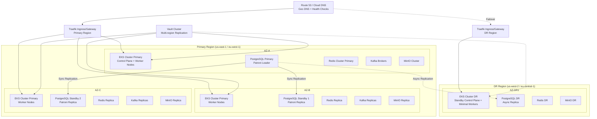
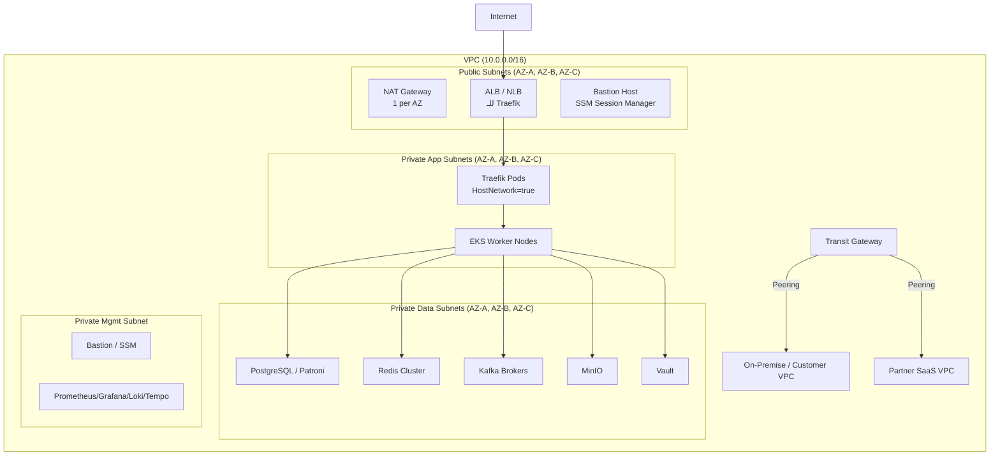

# DOC-06: هندسة البنية التحتية — NexusServiceCloud

---

| **معرّف الوثيقة** | DOC-06 |
|-------------------|--------|
| **العنوان** | هندسة البنية التحتية: طوبولوجيا، Kubernetes، بيانات، شبكات، أمان، مراقبة |
| **الإصدار** | 1.0.0 |
| **الحالة** | ✓ معتمد |
| **المالك** | هندسة المنصة / DevOps |
| **تاريخ التحديث** | 2026-11-09 |
| **التصنيف** | داخلي — سري |
| **الوثائق ذات الصلة** | [DOC-05 هندسة التطبيق](../00-overview/05-application-architecture.md)، [DOC-07 تصميم API](../00-overview/07-api-design.md)، [DOC-11 DevOps](../00-overview/11-devops-cicd.md)، [DOC-12 الأمان](../00-overview/12-security-architecture.md)، [DOC-13 المراقبة](../00-overview/13-observability.md)، [DOC-15 دليل العمليات](../00-overview/15-operations-runbook.md)، [DOC-18 الملاحق](../00-overview/18-appendices.md) |
| **التتبع** | ADR-001،002،006،007،008،009،010،011،012،013،014،015،016،017،018،019،020،021،022 |

---

## 1. ملخص تنفيذي

تحدد هذه الوثيقة **هندسة البنية التحتية** لمنصة NexusServiceCloud، تغطي: **طوبولوجيا المنصة** (متعدد المناطق/مناطق توفر)، **مواصفات Kubernetes** (EKS/GKE/AKS)، **الشبكات** (Traefik v3، mTLS، DNS، سياسات شبكة Cilium)، **طبقة البيانات** (PostgreSQL 18 مع RLS، PgBouncer، Redis 8، MinIO/S3، Kafka/RabbitMQ)، **أمان البنية التحتية** (Vault، صور مقواة، Falco، سياسات شبكة)، **مكدس المراقبة** (Prometheus، Grafana، Loki، Tempo، OpenTelemetry)، **النسخ الاحتياطي/استعادة الكوارث** (RPO/RTO)، **التخطيط للسعة**، و **IaC** (Terraform + Ansible).

---

## 2. طوبولوجيا المنصة (Platform Topology)

### 2.1 استراتيجية النشر متعددة المناطق



### 2.2 مناطق التوفر والتوزيع

| المكون | المنطقة الأساسية | منطقة DR | استراتيجية النسخ | RPO | RTO |
|--------|-----------------|----------|-----------------|-----|-----|
| **Kubernetes Control Plane** | 3 AZs (Managed EKS) | 1 AZ (Standby) | Managed HA | 0 | < 5 min |
| **Worker Nodes** | 3 AZs (Auto Scaling Groups) | 1 AZ (Warm Pool) | Pod Distribution | 0 | < 3 min |
| **PostgreSQL (Patroni)** | Primary + 2 Sync Standby | 1 Async Replica | Streaming Replication | < 1s (Sync) / < 5min (Async) | < 2 min (Primary) / < 15 min (DR) |
| **Redis Cluster** | 3 Masters + 3 Replicas | 1 Replica | Redis Cluster Replication | < 1s | < 2 min |
| **Kafka** | 3 Brokers (ISR=2) | 1 Broker | MirrorMaker2 | < 1s | < 5 min |
| **MinIO** | 4 Nodes (Erasure Coding) | 4 Nodes | Cross-region Replication | < 1s | < 5 min |
| **Vault** | 3 Nodes (Raft) | 2 Nodes | Raft Replication | 0 | < 1 min |
| **Traefik** | 3+ Replicas per AZ | 2+ Replicas | DNS Failover | 0 | < 2 min (DNS TTL) |

---

## 3. مواصفات Kubernetes (Kubernetes Specifications)

### 3.1 تكوين المجموعة (Cluster Configuration)

| المعامل | القيمة | التبرير |
|----------|-------|----------|
| **إصدار K8s** | 1.29+ (LTS) | دعم طويل المدى، تصحيحات أمان |
| **CNI** | Cilium 1.15+ | eBPF، NetworkPolicy، mTLS، Hubble observability |
| **CSI** | AWS EBS CSI / GCP PD CSI / Azure Disk CSI | تخزين مستمر ديناميكي |
| **Ingress** | Traefik v3 (CRD IngressRoute) | mTLS، RateLimit، WAF، Canary |
| **Service Mesh** | Cilium Service Mesh (بديل Istio) | خفيف، eBPF، لا sidecar |
| **DNS** | CoreDNS + ExternalDNS | اكتشاف خدمة، DNS خارجي |
| **Cert Manager** | cert-manager 1.14+ | شهادات TLS مدارة، ACME، Vault issuer |
| **Secrets** | External Secrets Operator + Vault | تزامن أسرار من Vault |
| **Monitoring** | Prometheus Operator + Grafana Agent | مقاييس، سجلات، آثار |
| **Logging** | Loki + Promtail (DaemonSet) | تجميع سجلات مركزي |
| **Tracing** | Tempo + OpenTelemetry Collector | تتبع موزع |
| **Backup** | Velero + Restic | نسخ احتياطي موارد K8s + PV |
| **GitOps** | ArgoCD (App of Apps pattern) | تسليم تصريحي |

### 3.2 مجموعات العقد (Node Groups)

| مجموعة العقد | نوع المثيل | الحجم | التوسع التلقائي | الأعباء | التسميات/التلوثات |
|-------------|-----------|------|----------------|---------|------------------|
| **system** | m6i.xlarge / n2-standard-4 | 3-6 | HPA: CPU>70% | CoreDNS، kube-proxy، CSI، Cert-Manager، Monitoring | `node-role.kubernetes.io/system=""` |
| **platform** | m6i.2xlarge / n2-standard-8 | 3-20 | HPA: CPU>60%, Memory>70% | Traefik، Vault، ArgoCD، Operators، Kafka، MinIO | `workload=platform` |
| **application** | m6i.2xlarge / n2-standard-8 | 5-100 | HPA: Custom Metrics (Queue Depth, RPS) | Django API، Workers، BFF، Celery | `workload=application` |
| **data** | r6g.2xlarge / n2-highmem-8 | 3-10 | Manual / Scheduled | PostgreSQL (Patroni)، Redis، Elasticsearch (إن وجد) | `workload=data`، `NoSchedule` taint |
| **ai** | g5.xlarge / a2-highgpu-1g | 0-10 | HPA: GPU Utilization | AI Inference Workers | `workload=ai`، `nvidia.com/gpu=present` |
| **batch** | m6i.large / n2-standard-2 | 0-50 | KEDA: Queue Length | Celery Batch Jobs، Sync، Reports | `workload=batch` |

### 3.3 موارد الفضاءات الاسمية (Namespace Resources)

| الفضاء الاسمي | الغرض | الحصص (Quotas) | حد المدى (LimitRange) | سياسات الشبكة |
|--------------|-------|----------------|----------------------|----------------|
| **nxa-system** | مكونات المنصة الأساسية | CPU: 8، Memory: 16Gi، Pods: 50 | Default: 500m/1Gi، Max: 2/4Gi | Default deny، allow platform ↔ platform |
| **nxa-platform** | خدمات المنصة (Vault، ArgoCD، إلخ) | CPU: 16، Memory: 32Gi، Pods: 100 | Default: 1/2Gi، Max: 4/8Gi | Allow platform ↔ data، platform ↔ app |
| **nxa-prod** | أحمال تطبيقات الإنتاج | CPU: 200، Memory: 500Gi، Pods: 500 | Default: 500m/1Gi، Max: 4/8Gi | Tenant isolation عبر Cilium NetworkPolicy |
| **nxa-staging** | بيئة التدريج | CPU: 50، Memory: 100Gi، Pods: 200 | Default: 500m/1Gi، Max: 2/4Gi | نسخ إنتاج مبسط |
| **nxa-dev** | بيئات التطوير | CPU: 20، Memory: 40Gi، Pods: 100 | Default: 250m/512Mi، Max: 2/2Gi | مفتوح للتطوير |
| **observability** | Prometheus، Grafana، Loki، Tempo | CPU: 32، Memory: 128Gi، Pods: 100 | Default: 1/2Gi، Max: 4/16Gi | Allow جميع الفضاءات → observability |
| **infra-data** | قواعد البيانات، طوابير الرسائل | CPU: 64، Memory: 256Gi، Pods: 50 | Default: 2/4Gi، Max: 8/32Gi | Allow app → data، data ↔ data |

---

## 4. الشبكات (Networking)

### 4.1 بنية VPC



### 4.2 Traefik v3 Configuration

```yaml
# traefik-values.yaml (Helm)
ports:
  web:
    port: 8000
    expose: false
  websecure:
    port: 8443
    expose: true
    tls:
      enabled: true
      certResolver: vault
      domains:
        - main: "*.nexusservicecloud.com"
          sans:
            - "nexusservicecloud.com"

providers:
  kubernetesCRD:
    enabled: true
    allowCrossNamespace: true
    labelSelector: "traefik.enable=true"
  kubernetesIngress:
    enabled: false

ingressRoute:
  dashboard:
    enabled: true
    match: "Host(`traefik.nexusservicecloud.com`)"
    middlewares:
      - "auth@kubernetescrd"
      - "ratelimit@kubernetescrd"

middleware:
  ratelimit:
    rateLimit:
      average: 1000
      burst: 2000
      sourceCriterion:
        ipStrategy:
          depth: 1
        headerName: "X-Forwarded-For"
  
  auth:
    forwardAuth:
      address: "http://nxa-api.nxa-prod.svc.cluster.local:8000/api/v1/auth/validate"
      trustForwardHeader: true
      authResponseHeaders:
        - "X-User-ID"
        - "X-Tenant-ID"
        - "X-Roles"
        - "X-Permissions"

tls:
  stores:
    default:
      defaultCertificate:
        secretName: "wildcard-nexusservicecloud-tls"
  options:
    default:
      minVersion: "VersionTLS13"
      cipherSuites:
        - "TLS_AES_256_GCM_SHA384"
        - "TLS_CHACHA20_POLY1305_SHA256"
      curvePreferences:
        - "X25519"
        - "P256"

certificatesResolvers:
  vault:
    vault:
      endpoint: "https://vault.nxa-system.svc.cluster.local:8200"
      role: "traefik-pki"
      secretName: "traefik-tls"
      authMethod: "kubernetes"
      mountPath: "pki"
```

### 4.3 سياسات شبكة Cilium (Cilium Network Policies)

```yaml
# cilium-network-policies.yaml
apiVersion: "cilium.io/v2"
kind: CiliumNetworkPolicy
metadata:
  name: tenant-isolation
  namespace: nxa-prod
spec:
  description: "عزل المستأجرين: لا تواصل بين Pods مستأجرين مختلفين"
  endpointSelector:
    matchLabels:
      workload: application
  ingress:
  - fromEndpoints:
    - matchLabels:
        workload: application
    - matchLabels:
        workload: platform
    - matchLabels:
        k8s:io.kubernetes.pod.namespace: nxa-system
    toPorts:
    - ports:
      - port: "8000"
        protocol: TCP
      rules:
        http:
        - method: "GET"
          path: "/health"
        - method: "POST"
          path: "/api/v1/.*"
      # التحقق من تطابق tenant_id في الهدر
        - header: "X-Tenant-ID"
          regex: ".*"  # يتم التحقق في التطبيق
---
apiVersion: "cilium.io/v2"
kind: CiliumNetworkPolicy
metadata:
  name: data-layer-access
  namespace: nxa-prod
spec:
  endpointSelector:
    matchLabels:
      workload: data
  ingress:
  - fromEndpoints:
    - matchLabels:
        workload: application
    - matchLabels:
        workload: platform
    toPorts:
    - ports:
      - port: "5432"
        protocol: TCP
      - port: "6379"
        protocol: TCP
      - port: "9092"
        protocol: TCP
      - port: "9000"
        protocol: TCP
      - port: "8200"
        protocol: TCP
---
apiVersion: "cilium.io/v2"
kind: CiliumClusterwideNetworkPolicy
metadata:
  name: egress-external
spec:
  description: "التحكم في الخروج الخارجي: فقط النطاقات المسموحة"
  endpointSelector:
    matchLabels:
      egress: "allowed"
  egress:
  - toCIDRSet:
    - cidr: "0.0.0.0/0"
      except:
      - "10.0.0.0/8"
      - "172.16.0.0/12"
      - "192.168.0.0/16"
    toPorts:
    - ports:
      - port: "443"
        protocol: TCP
      - port: "53"
        protocol: UDP
      rules:
        dns:
        - matchPattern: "*.nexusservicecloud.com"
        - matchPattern: "*.amazonaws.com"
        - matchPattern: "*.googleapis.com"
        - matchPattern: "api.github.com"
```

### 4.4 mTLS مع Cilium

```yaml
# cilium-mtls-config.yaml
apiVersion: cilium.io/v2alpha1
kind: CiliumMTLSConfig
metadata:
  name: mtls-config
  namespace: nxa-system
spec:
  nodeTLS: true
  workloadTLS: true
  ca:
    mode: "csi"  # استخدام CSI driver للشهادات
  destCA: {}
```

---

## 5. طبقة البيانات (Data Layer)

### 5.1 PostgreSQL 18 مع Patroni (HA)

```yaml
# patroni-config.yml (ConfigMap)
scope: nxa-postgresql
namespace: /nxa/prod/postgresql/
name: postgresql-ha

restapi:
  listen: 0.0.0.0:8008
  connect_address: ${POD_IP}:8008

etcd:
  host: etcd-cluster.nxa-system.svc.cluster.local:2379
  protocol: https
  cacert: /etc/etcd/ca.crt
  cert: /etc/etcd/client.crt
  key: /etc/etcd/client.key

bootstrap:
  dcs:
    ttl: 30
    loop_wait: 10
    retry_timeout: 10
    maximum_lag_on_failover: 1048576
    synchronous_mode: true
    synchronous_node_count: 2
    postgresql:
      use_pg_rewind: true
      use_slots: true
      parameters:
        max_connections: "500"
        shared_buffers: "4GB"
        effective_cache_size: "12GB"
        maintenance_work_mem: "1GB"
        checkpoint_completion_target: "0.9"
        wal_buffers: "64MB"
        default_statistics_target: "100"
        random_page_cost: "1.1"
        effective_io_concurrency: "200"
        work_mem: "32MB"
        min_wal_size: "2GB"
        max_wal_size: "8GB"
        wal_level: "replica"
        max_wal_senders: "10"
        max_replication_slots: "10"
        hot_standby: "on"
        hot_standby_feedback: "on"
        wal_keep_size: "2GB"
        track_commit_timestamp: "on"
        log_min_duration_statement: "1000"
        log_checkpoints: "on"
        log_connections: "on"
        log_disconnections: "on"
        log_lock_waits: "on"
        log_temp_files: "0"
        log_autovacuum_min_duration: "1000"
        pg_stat_statements.track: "all"
        pg_stat_statements.max: "10000"

postgresql:
  listen: 0.0.0.0:5432
  connect_address: ${POD_IP}:5432
  data_dir: /var/lib/postgresql/data
  bin_dir: /usr/lib/postgresql/18/bin
  authentication:
    superuser:
      username: postgres
      password: ${POSTGRES_SUPERUSER_PASSWORD}
    replication:
      username: replicator
      password: ${POSTGRES_REPLICATION_PASSWORD}
  parameters:
    max_prepared_transactions: "100"
  pg_hba:
  - local all all trust
  - host all all 0.0.0.0/0 md5
  - host replication replicator 0.0.0.0/0 md5
  - host all all 0.0.0.0/0 md5 clientcert=1

tags:
  nofailover: false
  noloadbalance: false
  clonefrom: false
```

### 5.2 PgBouncer (Connection Pooler)

```yaml
# pgbouncer-config.ini
[databases]
nxa = host=postgresql-ha.nxa-prod.svc.cluster.local port=5432 dbname=nxa auth_user=pgbouncer

[pgbouncer]
listen_addr = 0.0.0.0
listen_port = 6432
auth_type = md5
auth_file = /etc/pgbouncer/userlist.txt
admin_users = pgbouncer, postgres
stats_users = pgbouncer, postgres

pool_mode = transaction
max_client_conn = 10000
default_pool_size = 100
min_pool_size = 20
reserve_pool_size = 10
reserve_pool_timeout = 5

max_db_connections = 500
max_user_connections = 500

syslog = 1
syslog_ident = pgbouncer
syslog_facility = daemon

log_connections = 1
log_disconnections = 1
log_pooler_errors = 1

ignore_startup_parameters = extra_float_digits, application_name
```

### 5.3 Redis 8 Cluster

```yaml
# redis-cluster-values.yaml (Helm)
cluster:
  enabled: true
  nodes: 6
  replicas: 1
  redisVersion: "8.0"
  
resources:
  limits:
    cpu: "2000m"
    memory: "4Gi"
  requests:
    cpu: "1000m"
    memory: "2Gi"

persistence:
  enabled: true
  size: 20Gi
  storageClass: gp3

redis:
  password: ${REDIS_PASSWORD}
  maxmemory: "3500MB"
  maxmemoryPolicy: "allkeys-lru"
  timeout: 300
  tcpKeepalive: 60
  
  # Cluster config
  clusterEnabled: "yes"
  clusterNodeTimeout: 15000
  clusterRequireFullCoverage: "yes"
  
  # Persistence
  appendonly: "yes"
  appendfsync: "everysec"
  save: "900 1 300 10 60 10000"
  
  # Security
  tls:
    enabled: true
    certFile: /etc/redis/tls/tls.crt
    keyFile: /etc/redis/tls/tls.key
    caFile: /etc/redis/tls/ca.crt

metrics:
  enabled: true
  serviceMonitor:
    enabled: true
    interval: 30s

# Sentinel for HA (بديل Cluster mode)
sentinel:
  enabled: false
```

### 5.4 Kafka / RabbitMQ للمراسلة

```yaml
# kafka-values.yaml (Strimzi Operator)
apiVersion: kafka.strimzi.io/v1beta2
kind: Kafka
metadata:
  name: nxa-kafka
  namespace: infra-data
spec:
  kafka:
    version: 3.7
    replicas: 6
    resources:
      requests:
        memory: 4Gi
        cpu: "2000m"
      limits:
        memory: 8Gi
        cpu: "4000m"
    config:
      offsets.topic.replication.factor: 3
      transaction.state.log.replication.factor: 3
      transaction.state.log.min.isr: 2
      default.replication.factor: 3
      min.insync.replicas: 2
      unclean.leader.election.enable: false
      auto.create.topics.enable: false
      log.retention.hours: 168
      log.retention.bytes: 10737418240
      log.segment.bytes: 1073741824
      compression.type: zstd
      num.network.threads: 8
      num.io.threads: 16
      socket.send.buffer.bytes: 102400
      socket.receive.buffer.bytes: 102400
      socket.request.max.bytes: 104857600
    storage:
      type: persistent-claim
      size: 100Gi
      class: gp3
      deleteClaim: false
    rack:
      topologyKey: topology.kubernetes.io/zone
  zookeeper:
    replicas: 3
    resources:
      requests:
        memory: 1Gi
        cpu: "500m"
      limits:
        memory: 2Gi
        cpu: "1000m"
    storage:
      type: persistent-claim
      size: 20Gi
      class: gp3
  entityOperator:
    topicOperator: {}
    userOperator: {}
```

```yaml
# rabbitmq-values.yaml (للأعباء التي تحتاج RabbitMQ)
replicas: 3
resources:
  limits:
    cpu: "2000m"
    memory: "4Gi"
  requests:
    cpu: "1000m"
    memory: "2Gi"

persistence:
  enabled: true
  size: 20Gi

rabbitmq:
  username: admin
  password: ${RABBITMQ_PASSWORD}
  erlangCookie: ${RABBITMQ_ERLANG_COOKIE}
  
  # HA Policy
  policies:
    - name: ha-all
      pattern: "^(?!amq\.).*"
      definition:
        ha-mode: "exactly"
        ha-params: 3
        ha-sync-mode: "automatic"
      priority: 1
      apply-to: "all"
  
  # Quorum Queues (RabbitMQ 3.8+)
  quorumQueues: true
  
  # TLS
  ssl:
    enabled: true
    certFile: /etc/rabbitmq/tls/tls.crt
    keyFile: /etc/rabbitmq/tls/tls.key
    caFile: /etc/rabbitmq/tls/ca.crt
    verify: verify_peer
    failIfNoPeerCert: true

metrics:
  enabled: true
  serviceMonitor:
    enabled: true
```

### 5.5 MinIO (Object Storage)

```yaml
# minio-values.yaml (Helm)
mode: distributed
replicas: 4
pools:
  - name: pool-1
    servers: 4
    volumesPerServer: 4

resources:
  limits:
    cpu: "2000m"
    memory: "4Gi"
  requests:
    cpu: "1000m"
    memory: "2Gi"

persistence:
  enabled: true
  size: 50Gi
  storageClass: gp3

minio:
  rootUser: minioadmin
  rootPassword: ${MINIO_ROOT_PASSWORD}
  
  # Erasure Coding: 4 nodes, 4 volumes = 16 drives, parity 8
  # Can lose up to 8 drives (half)
  
  # Encryption
  encryption:
    sse-s3: true
    sse-kms: false
  
  # Versioning
  versioning: true
  
  # Lifecycle
  lifecycle:
    enabled: true
    rules:
      - id: expire-incomplete-multipart
        status: Enabled
        abortIncompleteMultipartUpload:
          daysAfterInitiation: 7
  
  # Replication (Cross-region)
  replication:
    enabled: true
    target:
      endpoint: "https://minio-dr.nxa-dr.svc.cluster.local:9000"
      bucket: "nexus-attachments-dr"
      accessKey: ${MINIO_DR_ACCESS_KEY}
      secretKey: ${MINIO_DR_SECRET_KEY}
      replicationRules:
        - id: replicate-all
          status: Enabled
          priority: 1
          deleteMarkerReplication: Enabled
          filter:
            prefix: ""
  
  # TLS
  tls:
    enabled: true
    certFile: /etc/minio/tls/tls.crt
    keyFile: /etc/minio/tls/tls.key

metrics:
  enabled: true
  serviceMonitor:
    enabled: true
```

---

## 6. أمان البنية التحتية (Infrastructure Security)

### 6.1 HashiCorp Vault

```yaml
# vault-values.yaml (Helm)
server:
  resources:
    limits:
      cpu: "1000m"
      memory: "2Gi"
    requests:
      cpu: "500m"
      memory: "1Gi"
  
  # Raft Storage (Integrated Storage)
  storage:
    raft:
      enabled: true
      setNodeId: true
      config: |
        storage "raft" {
          path = "/vault/data"
        }
        listener "tcp" {
          address = "0.0.0.0:8200"
          tls_cert_file = "/vault/tls/tls.crt"
          tls_key_file = "/vault/tls/tls.key"
          tls_client_ca_file = "/vault/tls/ca.crt"
        }
        seal "awskms" {
          region = "us-east-1"
          kms_key_id = "${VAULT_KMS_KEY_ID}"
        }
  
  # HA Configuration
  ha:
    enabled: true
    replicas: 3
    raft:
      enabled: true
  
  # TLS
  tls:
    enabled: true
    certFile: /etc/vault/tls/tls.crt
    keyFile: /etc/vault/tls/tls.key
    caFile: /etc/vault/tls/ca.crt
  
  # Audit
  audit:
    enabled: true
    devices:
      - type: file
        options:
          path: /vault/logs/audit.log
          mode: "0600"
      - type: syslog
        options:
          facility: "LOCAL0"

injector:
  enabled: true
  resources:
    limits:
      cpu: "500m"
      memory: "512Mi"

csi:
  enabled: true
```

### 6.2 سياسات Vault للمسارات (Vault Policies)

```hcl
# vault-policies/nxa-application.hcl
# سياسة لتطبيقات Django
path "secret/data/nxa/prod/{{identity.entity.aliases.auth_k8s.metadata.namespace}}/*" {
  capabilities = ["read", "list"]
}

path "secret/metadata/nxa/prod/{{identity.entity.aliases.auth_k8s.metadata.namespace}}/*" {
  capabilities = ["read", "list"]
}

# Database credentials (dynamic secrets)
path "database/creds/nxa-readonly" {
  capabilities = ["read"]
}

path "database/creds/nxa-readwrite" {
  capabilities = ["read"]
}

# PKI certificates for mTLS
path "pki/issue/nxa-internal" {
  capabilities = ["create", "update"]
}

path "pki/cert/ca" {
  capabilities = ["read"]
}

# Transit encryption for field-level encryption
path "transit/encrypt/nxa-field-encryption" {
  capabilities = ["update"]
}

path "transit/decrypt/nxa-field-encryption" {
  capabilities = ["update"]
}

# KV v2 for application config
path "secret/data/nxa/config/*" {
  capabilities = ["read", "list"]
}
```

```hcl
# vault-policies/nxa-traefik.hcl
# سياسة لـ Traefik PKI
path "pki/issue/traefik-cert" {
  capabilities = ["create", "update"]
}

path "pki/cert/ca" {
  capabilities = ["read"]
}
```

### 6.3 External Secrets Operator

```yaml
# external-secret.yaml
apiVersion: external-secrets.io/v1beta1
kind: ClusterSecretStore
metadata:
  name: vault-backend
spec:
  provider:
    vault:
      server: "https://vault.nxa-system.svc.cluster.local:8200"
      path: "secret"
      version: "v2"
      auth:
        kubernetes:
          mountPath: "kubernetes"
          role: "external-secrets"
          serviceAccountRef:
            name: external-secrets
            namespace: nxa-system
---
apiVersion: external-secrets.io/v1beta1
kind: ExternalSecret
metadata:
  name: nxa-database-credentials
  namespace: nxa-prod
spec:
  refreshInterval: 1h
  secretStoreRef:
    name: vault-backend
    kind: ClusterSecretStore
  target:
    name: nxa-database-credentials
    creationPolicy: Owner
  data:
    - secretKey: username
      remoteRef:
        key: database/creds/nxa-readwrite
        property: username
    - secretKey: password
      remoteRef:
        key: database/creds/nxa-readwrite
        property: password
---
apiVersion: external-secrets.io/v1beta1
kind: ExternalSecret
metadata:
  name: nxa-tls-certificates
  namespace: nxa-system
spec:
  refreshInterval: 24h
  secretStoreRef:
    name: vault-backend
    kind: ClusterSecretStore
  target:
    name: wildcard-nexusservicecloud-tls
    creationPolicy: Owner
  data:
    - secretKey: tls.crt
      remoteRef:
        key: pki/cert/traefik
        property: certificate
    - secretKey: tls.key
      remoteRef:
        key: pki/cert/traefik
        property: private_key
    - secretKey: ca.crt
      remoteRef:
        key: pki/cert/ca
        property: certificate
```

### 6.4 صور حاويات مقواة (Hardened Container Images)

```dockerfile
# Dockerfile.base (Ubuntu 24.04 LTS Minimal)
FROM ubuntu:24.04 AS base

# Security: Non-root user
RUN groupadd -r appgroup -g 1000 && \
    useradd -r -g appgroup -u 1000 -m -s /bin/bash appuser

# Security: Remove unnecessary packages
RUN apt-get update && \
    apt-get install -y --no-install-recommends \
        ca-certificates \
        curl \
        tzdata \
        libpq5 \
    && apt-get clean \
    && rm -rf /var/lib/apt/lists/*

# Security: Set timezone
ENV TZ=UTC

# Security: Read-only root filesystem (will be enforced in K8s)
WORKDIR /app

# Copy application
COPY --chown=appuser:appgroup . /app

# Security: Switch to non-root
USER appuser

# Health check
HEALTHCHECK --interval=30s --timeout=10s --start-period=10s --retries=3 \
    CMD curl -f http://localhost:8000/health || exit 1

ENTRYPOINT ["python", "-m", "nxa_core.asgi"]
```

```dockerfile
# Dockerfile.django (Multi-stage Build)
FROM python:3.12-slim AS builder

WORKDIR /build
COPY requirements.txt .
RUN pip install --no-cache-dir --user -r requirements.txt

FROM base AS runtime

COPY --from=builder /root/.local /home/appuser/.local
ENV PATH=/home/appuser/.local/bin:$PATH

# Security: Drop capabilities
# في K8s: securityContext.dropCapabilities: ["ALL"]
# securityContext.runAsNonRoot: true
# securityContext.runAsUser: 1000
# securityContext.readOnlyRootFilesystem: true
# securityContext.allowPrivilegeEscalation: false
```

### 6.5 Falco (Runtime Security)

```yaml
# falco-values.yaml (Helm)
falco:
  enabled: true
  driver:
    kind: modern_ebpf
  rules:
    customRules:
      nxa-custom-rules: |
        # Detect suspicious file access
        - rule: Suspicious File Access
          desc: "Detect access to sensitive files"
          condition: >
            open_read and 
            (fd.name contains "/etc/passwd" or 
             fd.name contains "/etc/shadow" or
             fd.name contains "/etc/sudoers" or
             fd.name contains "/.ssh/" or
             fd.name contains "/.aws/" or
             fd.name contains "/.kube/")
          output: "Suspicious file access (user=%user.name file=%fd.name cmd=%proc.cmdline)"
          priority: WARNING
          tags: [file, suspicious]
        
        # Detect crypto mining
        - rule: Crypto Miner Detection
          desc: "Detect known crypto mining processes"
          condition: >
            proc.name in ("xmrig", "cpuminer", "minerd", "cgminer", "bfgminer")
          output: "Crypto miner detected (user=%user.name cmd=%proc.cmdline)"
          priority: CRITICAL
          tags: [crypto, miner]
        
        # Detect shell in container
        - rule: Shell in Container
          desc: "Detect shell execution in container"
          condition: >
            proc.name in ("bash", "sh", "zsh", "ksh") and
            container.id != host
          output: "Shell in container (user=%user.name container=%container.id cmd=%proc.cmdline)"
          priority: WARNING
          tags: [shell, container]
        
        # Detect Kubernetes secrets access
        - rule: K8s Secret Access
          desc: "Detect access to Kubernetes secrets"
          condition: >
            open_read and
            fd.name contains "/var/run/secrets/kubernetes.io/serviceaccount/"
          output: "K8s secret access (user=%user.name file=%fd.name cmd=%proc.cmdline)"
          priority: NOTICE
          tags: [k8s, secret]

falcosidekick:
  enabled: true
  webui:
    enabled: true
  config:
    slack:
      webhookurl: "${FALCO_SLACK_WEBHOOK}"
      channel: "#security-alerts"
    pagerduty:
      integrationkey: "${FALCO_PAGERDUTY_KEY}"
```

---

## 7. مكدس المراقبة (Observability Stack) - ملخص

> **ملاحظة:** التفاصيل الكاملة في [DOC-13 المراقبة](../00-overview/13-observability.md)

| المكون | الإصدار | النشر | الغرض |
|----------|---------|--------|--------|
| **OpenTelemetry Collector** | 0.118+ | DaemonSet + Deployment | استقبال، معالجة، تصدير التلتمتري |
| **Prometheus** | 2.53+ | Prometheus Operator (HA Pair + Thanos) | مقاييس، تنبيهات، تخزين طويل المدى |
| **Grafana** | 11.1+ | Deployment (HA) | لوحات معلومات، تنبيهات مرئية |
| **Loki** | 2.9+ | Distributed (Read/Write) | تجميع سجلات، استعلام LogQL |
| **Tempo** | 2.4+ | Distributed | تتبع موزع، تخزين آثار |
| **Promtail** | 2.9+ | DaemonSet | جمع سجلات من العقد |
| **Grafana Agent** | 0.38+ | DaemonSet/Deployment | وكيل موحد للمقاييس/السجلات/الآثار |

---

## 8. النسخ الاحتياطي واستعادة الكوارث (Backup & Disaster Recovery)

### 8.1 استراتيجية النسخ الاحتياطي

| البيانات | الطريقة | التكرار | الاحتفاظ | RPO | RTO |
|---------|---------|---------|----------|-----|-----|
| **PostgreSQL (Patroni)** | WAL-G (Continuous Archiving) | Continuous (WAL) + Daily Base Backup | 30 يوم Hot / 13 شهر Cold (S3) | < 1 ثانية | < 15 دقيقة (PITR) |
| **Redis** | RDB Snapshots + AOF | كل 6 ساعات | 7 أيام | < 6 ساعات | < 10 دقائق |
| **Kafka** | MirrorMaker2 to DR | Continuous | 7 أيام | < 1 ثانية | < 5 دقائق |
| **MinIO** | Cross-region Replication | Continuous | 90 يوم | < 1 ثانية | < 5 دقائق |
| **K8s Resources (Velero)** | Velero + Restic | يومي | 30 يوم | 24 ساعة | < 30 دقيقة |
| **Vault** | Raft Snapshots + Auto-unseal | كل ساعة | 30 يوم | < 1 ساعة | < 5 دقائق |
| **Etcd** | etcdctl snapshot | كل 6 ساعات | 7 أيام | < 6 ساعات | < 10 دقائق |

### 8.2 إجراءات استعادة الكوارث (DR Procedures)

```bash
# scripts/dr-failover.sh
#!/bin/bash
# فشل منطقة أولية → تفعيل منطقة DR

set -euo pipefail

PRIMARY_REGION="us-east-1"
DR_REGION="us-west-2"
CLUSTER_NAME="nxa-prod"

echo "=== DR Failover Initiated ==="
echo "Primary: $PRIMARY_REGION"
echo "DR: $DR_REGION"

# 1. التحقق من صحة المنطقة الأساسية
echo "Checking primary region health..."
if aws route53 get-health-check-status --health-check-id $PRIMARY_HC_ID --region $PRIMARY_REGION | grep -q "HEALTHY"; then
    echo "Primary region appears healthy. Abort?"
    read -p "Continue anyway? (yes/no): " confirm
    if [[ "$confirm" != "yes" ]]; then exit 1; fi
fi

# 2. ترقية PostgreSQL DR إلى Primary
echo "Promoting PostgreSQL DR replica to primary..."
kubectl --context=$DR_REGION exec -n infra-data postgresql-dr-0 -- patronictl failover --cluster=nxa-postgresql --candidate=postgresql-dr-0

# 3. تحديث DNS إلى منطقة DR
echo "Updating DNS to DR region..."
aws route53 change-resource-record-sets --hosted-zone-id $HOSTED_ZONE_ID --change-batch file://dr-dns-change.json --region $DR_REGION

# 4. توسيع عقد DR K8s
echo "Scaling DR cluster worker nodes..."
aws eks update-nodegroup-config --cluster-name $CLUSTER_NAME-dr --nodegroup-name application-dr --scaling-config minSize=10,maxSize=100,desiredSize=20 --region $DR_REGION

# 5. التحقق من صحة الخدمات
echo "Verifying service health in DR..."
sleep 60
./scripts/health_check_all.sh --context=$DR_REGION

# 6. تحديث StatusPage
echo "Updating StatusPage..."
curl -X POST $STATUSPAGE_API/incidents \
  -H "Authorization: Bearer $STATUSPAGE_TOKEN" \
  -d '{"incident":{"name":"Regional Failover","status":"investigating","impact":"minor","components":["api","web"]}}'

echo "=== DR Failover Completed ==="
echo "Monitor: https://grafana-dr.nexusservicecloud.com"
```

### 8.3 Point-in-Time Recovery (PITR) لـ PostgreSQL

```bash
# scripts/pitr-restore.sh
#!/bin/bash
# استعادة قاعدة بيانات إلى نقطة زمنية محددة

TARGET_TIME="${1:-$(date -d '1 hour ago' -Iseconds)}"
TARGET_DB="nxa"
RECOVERY_NAMESPACE="nxa-recovery"

echo "=== PITR Recovery to $TARGET_TIME ==="

# 1. إنشاء فضاء اسم للاستعادة
kubectl create namespace $RECOVERY_NAMESPACE --dry-run=client -o yaml | kubectl apply -f -

# 2. استعادة من WAL-G
wal-g backup-fetch \
  --target-time="$TARGET_TIME" \
  --target-db="$TARGET_DB" \
  --namespace=$RECOVERY_NAMESPACE \
  --source=s3://nxa-wal-g-backups/prod/

# 3. التحقق من سلامة البيانات
kubectl exec -n $RECOVERY_NAMESPACE postgresql-0 -- pg_dump -Fc $TARGET_DB > /tmp/recovery_verify.dump
pg_restore --list /tmp/recovery_verify.dump | head -20

# 4. تشغيل استعلامات تحقق
kubectl exec -n $RECOVERY_NAMESPACE postgresql-0 -- psql -d $TARGET_DB -c "
  SELECT COUNT(*) FROM nxa_requests_request;
  SELECT COUNT(*) FROM nxa_assets_asset;
  SELECT MAX(updated_at) FROM nxa_requests_request;
"

echo "=== Recovery verification complete ==="
echo "To promote: swap DNS/service endpoints to $RECOVERY_NAMESPACE"
```

---

## 9. التخطيط للسعة (Capacity Planning)

### 9.1 نماذج السعة

| المورد | الاستخدام الحالي | النمو المتوقع (سنوي) | حد التوسع | إجراء عند 80% |
|---------|----------------|---------------------|-----------|---------------|
| **CPU (Application)** | 45% | 2.5x | 100 عقدة | توسع تلقائي (HPA) + إضافة Node Group |
| **Memory (Application)** | 55% | 2x | 500 GiB | توسع تلقائي + تحسين استعلامات |
| **CPU (Database)** | 60% | 3x | 32 vCPU (r6g.8xlarge) | ترقية مثيل + Read Replicas |
| **Memory (Database)** | 70% | 2.5x | 256 GiB | ترقية مثيل + Partitioning |
| **Storage (PostgreSQL)** | 40% (2 TB / 5 TB) | 1.5 TB/سنة | 20 TB | أرشفة بيانات قديمة، ضغط |
| **Storage (MinIO)** | 30% (50 TB / 200 TB) | 30 TB/سنة | 500 TB | إضافة عقد MinIO |
| **Redis Memory** | 50% (20 GB / 40 GB) | 1.5x | 100 GB | ترقية عقد، Cluster Mode |
| **Kafka Storage** | 25% (10 TB / 40 TB) | 5 TB/سنة | 100 TB | إضافة Brokers، زيادة Retention |
| **Network (VPC)** | 15% (CIDR /16) | ثابت | /16 | طلب CIDR إضافي |

### 9.2 اختبارات الحمل (Load Testing)

```yaml
# k6-load-test.yml (GitHub Actions)
name: Load Test
on:
  schedule:
    - cron: '0 2 * * 0'  # أسبوعي يوم الأحد 2 AM
  workflow_dispatch:

jobs:
  load-test:
    runs-on: ubuntu-latest
    steps:
      - uses: actions/checkout@v4
      
      - name: Setup k6
        uses: grafana/k6-action@v0.2.0
      
      - name: Run Load Test
        run: |
          k6 run --vus 500 --duration 30m \
            -e BASE_URL=https://staging.nexusservicecloud.com \
            -e TENANT_ID=test-tenant \
            tests/load/api_load_test.js
      
      - name: Check Thresholds
        run: |
          k6 run --vus 1000 --duration 15m \
            -e BASE_URL=https://staging.nexusservicecloud.com \
            tests/load/stress_test.js
      
      - name: Publish Results
        uses: actions/upload-artifact@v4
        with:
          name: k6-results
          path: results/
```

---

## 10. Infrastructure as Code (IaC)

### 10.1 هيكل Terraform

```
infrastructure/terraform/
├── modules/
│   ├── vpc/
│   ├── eks/
│   ├── rds-postgresql/
│   ├── elasticache-redis/
│   ├── msk-kafka/
│   ├── minio/
│   ├── vault/
│   ├── traefik/
│   ├── monitoring/
│   └── dr-region/
├── environments/
│   ├── production/
│   │   ├── main.tf
│   │   ├── variables.tf
│   │   ├── outputs.tf
│   │   └── terraform.tfvars
│   ├── staging/
│   └── development/
├── providers.tf
├── versions.tf
└── backend.tf
```

### 10.2 مثال: وحدة EKS

```hcl
# modules/eks/main.tf
module "eks" {
  source  = "terraform-aws-modules/eks/aws"
  version = "~> 19.0"
  
  cluster_name    = var.cluster_name
  cluster_version = "1.29"
  
  vpc_id                         = module.vpc.vpc_id
  subnet_ids                     = module.vpc.private_subnets
  cluster_endpoint_public_access = true
  cluster_endpoint_private_access = true
  
  # Managed Node Groups
  eks_managed_node_groups = {
    system = {
      name           = "${var.cluster_name}-system"
      instance_types = ["m6i.xlarge"]
      capacity_type  = "ON_DEMAND"
      
      min_size     = 3
      max_size     = 6
      desired_size = 3
      
      labels = {
        node-role.kubernetes.io/system = ""
        workload = "system"
      }
      
      taints = [{
        key    = "node-role.kubernetes.io/system"
        value  = ""
        effect = "NO_SCHEDULE"
      }]
    }
    
    platform = {
      name           = "${var.cluster_name}-platform"
      instance_types = ["m6i.2xlarge"]
      capacity_type  = "ON_DEMAND"
      
      min_size     = 3
      max_size     = 20
      desired_size = 5
      
      labels = {
        workload = "platform"
      }
    }
    
    application = {
      name           = "${var.cluster_name}-application"
      instance_types = ["m6i.2xlarge", "m6i.4xlarge"]
      capacity_type  = "MIXED"
      
      min_size     = 5
      max_size     = 100
      desired_size = 10
      
      labels = {
        workload = "application"
      }
    }
    
    data = {
      name           = "${var.cluster_name}-data"
      instance_types = ["r6g.2xlarge"]
      capacity_type  = "ON_DEMAND"
      
      min_size     = 3
      max_size     = 10
      desired_size = 3
      
      labels = {
        workload = "data"
      }
      
      taints = [{
        key    = "workload"
        value  = "data"
        effect = "NO_SCHEDULE"
      }]
    }
  }
  
  # Add-ons
  enable_irsa = true
  
  cluster_addons = {
    vpc-cni = {
      most_recent = true
    }
    coredns = {
      most_recent = true
    }
    kube-proxy = {
      most_recent = true
    }
    aws-ebs-csi-driver = {
      most_recent = true
    }
  }
  
  # Encryption
  enable_cluster_encryption = true
  encryption_config = [{
    provider_key_arn = aws_kms_key.eks.arn
    resources        = ["secrets"]
  }]
  
  # Logging
  cluster_log_group_name = "/aws/eks/${var.cluster_name}/logs"
  
  tags = var.common_tags
}
```

### 10.3 Ansible للمهام التشغيلية

```yaml
# ansible/playbooks/postgresql-maintenance.yml
---
- name: PostgreSQL Maintenance
  hosts: postgresql_servers
  become: yes
  vars:
    maintenance_window: "02:00-04:00 UTC"
  tasks:
    - name: Check pg_stat_statements for slow queries
      command: psql -c "SELECT query, mean_time, calls FROM pg_stat_statements ORDER BY mean_time DESC LIMIT 20;"
      register: slow_queries
    
    - name: Vacuum analyze bloated tables
      command: psql -c "VACUUM ANALYZE;"
      when: "'autovacuum' not in slow_queries.stdout"
    
    - name: Reindex bloated indexes
      command: psql -c "REINDEX TABLE CONCURRENTLY nxa_requests_request;"
      when: "'index' in slow_queries.stdout"
    
    - name: Check replication lag
      command: psql -c "SELECT * FROM pg_stat_replication;"
      register: replication_status
    
    - name: Alert if replication lag > 30s
      uri:
        url: "{{ alertmanager_url }}/api/v1/alerts"
        method: POST
        body_format: json
        body:
          labels:
            alertname: "PostgreSQLReplicationLag"
            severity: "warning"
          annotations:
            summary: "Replication lag > 30s on {{ inventory_hostname }}"
      when: "'30' in replication_status.stdout"
```

---

## 11. قرارات معمارية مرتبطة (Related ADRs)

| ADR | العنوان | القرار الرئيسي |
|-----|--------|----------------|
| **ADR-001** | Modular Monolith على Kubernetes | نمط النشر الأولي |
| **ADR-002** | PostgreSQL 18 + Patroni + RLS | قاعدة بيانات مع عزل مستأجر |
| **ADR-006** | Redis 8 Cluster / RabbitMQ | تخزين مؤقت وطوابير رسائل |
| **ADR-007** | Traefik v3 Ingress | بوابة API مع mTLS، RateLimit |
| **ADR-008** | Cilium CNI + NetworkPolicy | شبكة، mTLS، سياسات، رصد |
| **ADR-009** | Vault for Secrets | إدارة أسرار مركزية |
| **ADR-010** | GitOps with ArgoCD | تسليم تصريحي |
| **ADR-011** | OpenTelemetry Stack | مراقبة موحدة |
| **ADR-012** | Multi-region DR | منطقة أساسية + DR مع فشل آلي |
| **ADR-013** | Hardened Container Images | أمان وقت التشغيل |
| **ADR-014** | Velero for K8s Backup | نسخ احتياطي موارد K8s |
| **ADR-015** | Terraform + Ansible IaC | أتمتة البنية التحتية |

---

## 12. المراجع

| معرّف | العنوان | الرابط |
|-------|--------|-------|
| DOC-00 | الفهرس الرئيسي | [00-master-index.md](../00-overview/00-master-index.md) |
| DOC-05 | هندسة التطبيق | [05-application-architecture.md](../00-overview/05-application-architecture.md) |
| DOC-07 | تصميم API | [07-api-design.md](../00-overview/07-api-design.md) |
| DOC-11 | DevOps و CI/CD | [11-devops-cicd.md](../00-overview/11-devops-cicd.md) |
| DOC-12 | هندسة الأمان | [12-security-architecture.md](../00-overview/12-security-architecture.md) |
| DOC-13 | المراقبة | [13-observability.md](../00-overview/13-observability.md) |
| DOC-15 | دليل العمليات | [15-operations-runbook.md](../00-overview/15-operations-runbook.md) |
| DOC-18 | الملاحق (ADRs كاملة) | [18-appendices.md](../00-overview/18-appendices.md) |

---

> **التحكم في الوثيقة:** يتم صيانة هذه الوثيقة بواسطة هندسة المنصة و DevOps. تتطلب التغييرات مراجعة من لجنة مراجعة المعمارية. المراجعة القادمة: 2027-02-09.