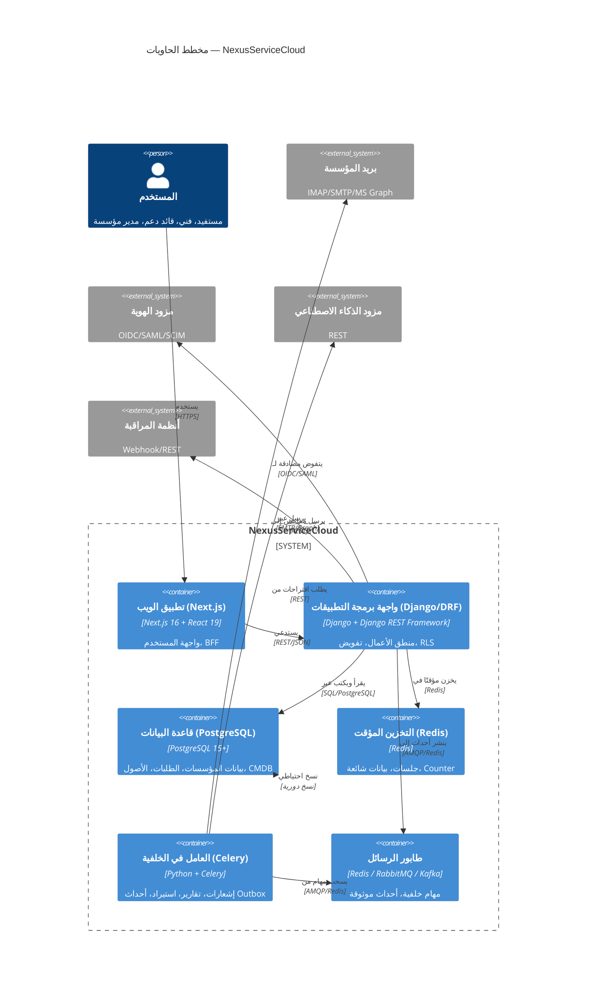
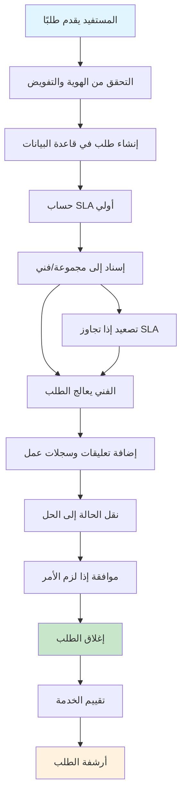
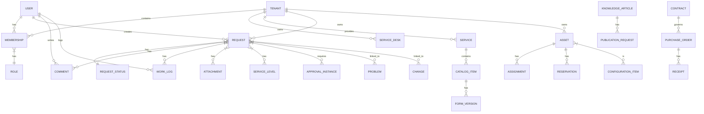

# DOC-13: المخططات والنماذج (Diagrams & Models) — NexusServiceCloud

---

| **معرّف الوثيقة** | DOC-13 |
|-------------------|--------|
| **العنوان** | مخططات السياق والتدفق والبيانات (C4 और نماذج البيانات) |
| **الإصدار** | 1.0.0 |
| **الحالة** | مسودة مقترحة |
| **المالك** | مهندس الحل / فريق الهندسة |
| **تاريخ التحديث** | 2026-11-09 |
| **التصنيف** | داخلي |
| **الوثائق ذات الصلة** | [DOC-01 الرؤية والنطاق](../00-overview/01-vision-scope.md)، [DOC-04 نموذج المجال](../00-overview/04-domain-model.md)، [DOC-05 هندسة التطبيق](../00-overview/05-application-architecture.md) |
| **التتبع** | DIA-C4-001، CAP-010..CAP-160 |

---

## 1. ملخص تنفيذي

توثق هذه الوثيقة المخططات عالية المستوى لنظام NexusServiceCloud وفقًا لنموذج C4 (السياق، الحاوية، المكون، الكود) مع مخططات تدفق البيانات ونماذج العلاقات المفاهيمية. المخططات تصفري ولم تُنفذ أي مكونات بعد.

---

## 2. مخطط السياق (C4 Level 1)

```mermaid
C4Context
    title مخطط السياق — NexusServiceCloud
    
    Person(beneficiary, "المستفيد", "موظف، متعاقد، مورد — يقدم طلبات ويتابعها")
    Person(technician, "الفني", "معالج الطلبات ضمن مجموعاته")
    Person(support_lead, "قائد الدعم", "يوزع الأحمال، يعالج التصعيد")
    Person(svc_owner, "مالك الخدمة", "يحدد الكتالوج وسياسة الخدمة والموافقات")
    Person(problem_mgr, "مدير المشكلة", "ينسق تحليل السبب الجذري")
    Person(change_mgr, "مدير التغيير / CAB", "يقيّم الأثر والمخاطر")
    Person(asset_mgr, "مدير الأصل / أمين المخزن", "يدير العهدة والاستلام والصيانة")
    Person(proc_mgr, "مسؤول المشتريات / الموافق المالي", "يفصل إنشاء طلب الشراء عن اعتماده")
    Person(org_admin, "مدير المؤسسة", "يدير إعدادات مؤسسته وعضوياتها")
    Person(auditor, "المدقق", "يقرأ أدلة نطاقه ولا يغيرها")
    Person(platform_admin, "مسؤول المنصة", "يشغّل البنية ولا يقرأ محتوى المؤسسات")
    
    System(nsc, "NexusServiceCloud", "منصة ITSM/ESM موحدة")
    
    System_Ext(email, "بريد المؤسسة", "IMAP/SMTP/MS Graph")
    System_Ext(monitoring, "أنظمة المراقبة", "Prometheus/Datadog")
    System_Ext(discovery, "أدوات الاكتشاف", "SNMP/SSH/API")
    System_Ext(identity, "مزود الهوية", "Entra ID / Okta / LDAP")
    System_Ext(payment, "بوابة الدفع", "Stripe/Adyen — اختياري")
    System_Ext(chat, "منصات المحادثة", "Slack/Teams")
    System_Ext(ai, "مزود الذكاء الاصطناعي", "OpenAI/Azure AI/محلي")
    
    Rel(beneficiary, nsc, "يستخدم", "HTTPS/REST/Web")
    Rel(technician, nsc, "يعالج", "HTTPS/REST/Web")
    Rel(support_lead, nsc, "يشرف", "HTTPS/REST/Web")
    Rel(svc_owner, nsc, "يحدد السياسات", "HTTPS/REST/Web")
    Rel(problem_mgr, nsc, "ينسق", "HTTPS/REST/Web")
    Rel(change_mgr, nsc, "يقيّم/يوافق", "HTTPS/REST/Web")
    Rel(asset_mgr, nsc, "يدير الأصول", "HTTPS/REST/Web")
    Rel(proc_mgr, nsc, "يدير المشتريات", "HTTPS/REST/Web")
    Rel(proj_mgr, nsc, "يخطط/يسلم", "HTTPS/REST/Web")
    Rel(org_admin, nsc, "يدير المؤسسة", "HTTPS/REST/Web")
    Rel(auditor, nsc, "يراجع", "HTTPS/READ-ONLY")
    Rel(platform_admin, nsc, "يشغل", "SSH/Kubectl/ArgoCD")
    
    Rel(nsc, email, "يستقبل/يرسل عبر", "IMAP/SMTP/Graph API")
    Rel(nsc, monitoring, "يستقبل أحداث من", "Webhook/REST")
    Rel(nsc, discovery, "يمزامن أصول من", "SNMP/SSH/REST")
    Rel(nsc, identity, "يتفوض مصادقة لـ", "OIDC/SAML/SCIM")
    Rel(nsc, payment, "يعالج دفعات عبر", "REST/Webhook")
    Rel(nsc, chat, "يرسل إشعارات إلى", "Webhook/Bot API")
    Rel(nsc, ai, "يطلب اقتراحات من", "REST/GraphQL")
```

---

## 3. مخطط الحاويات (C4 Level 2) — تصفري



---

## 4. مخطط تدفق الطلب (Service Request Lifecycle)



---

## 5. نموذج البيانات المفاهيمي (ERD ملخص)



### 5.1 الكيانات الرئيسية والسمات

| الكيان | السمات الأساسية | مالك البيانات |
|--------|----------------|-------------|
| Tenant | id، name، domain، settings، created_at | منصة |
| User | id، email، display_name، tenant_id، roles | مؤسسة |
| Membership | id، user_id، tenant_id، role_id، service_desk_id | مؤسسة |
| ServiceDesk | id، tenant_id، name، scope، visibility | مؤسسة |
| Service | id، tenant_id، name، category، sla_policy | مالك الخدمة |
| CatalogItem | id، service_id، name، form_version_id، visible_to | مالك الخدمة |
| Request | id، tenant_id، service_desk_id، item_id، requester_id، status، priority، created_at، updated_at | المؤسسة |
| Comment | id، request_id، author_id، text، visibility، created_at | المؤسسة |
| WorkLog | id، request_id、author_id、duration، started_at، description | المؤسسة |
| Attachment | id، request_id، file_name، storage_path، scanned، quarantine | المؤسسة |
| ServiceLevel | id، request_id، policy_id، response_due، resolution_due، breached | النظام |
| ApprovalInstance | id، request_id، step_id، approver_id، decision، version | المؤسسة |
| Asset | id، tenant_id، tag، name، type، status، location، assigned_to | مدير الأصل |
| ConfigurationItem | id، asset_id، ci_type، relations | مدير الأصل |
| PurchaseOrder | id، tenant_id، vendor_id، total، status، approved_by | المشتريات |
| Contract | id، tenant_id، vendor_id، start_date، end_date، terms | المشتريات |
| KnowledgeArticle | id، tenant_id، title، content، version、audience، published | معرف المعرفة |

---

## 6. مخططات تسلسلية رئيسية (مفترضة)

### 6.1 إنشاء طلب خدمة

```
المستفيد → واجهة الويب: تقديم طلب مع قيم النموذج
واجهة الويب → API: POST /service-requests
API → قاعدة البيانات: إنشاء طلب مع tenant_id من الجلسة
قاعدة البيانات → API: تم الإنشاء مع رقم الطلب ونسخة
API → عامل الخلفية: نشر حدث إنشاء طلب
عامل الخلفية → البريد: إرسال تأكيد الاستلام
عامل الخلفية → واجهة الويب: إشعار عبر WebSocket
```

### 6.2 نقل حالة الطلب

```
الفني → واجهة الويب: طلب نقل الحالة مع expected_version
واجهة الويب → API: POST /requests/{id}/transitions
API → قاعدة البيانات: التحقق من التفويض والنسخة
القاعدة → API: تحديث الحالة أو رفض مع 409
API → واجهة الويب: الحالة الجديدة أو سبب الرفض
```

---

## 7. القيود والافتراضات

| الرقم | الافتراض | الحالة |
|------|---------|--------|
| DIA-001 | مخططات C4 كافية للمرحلة P1 | مقبول |
| DIA-002 | نموذج البيانات المفاهيمي قد يتغير مع التصميم الفيزيائي | مفتوح |
| DIA-003 | لا توجد مخططات مكونات (C4 Level 3) بعد | مؤجل |

---

## 8. المراجع المرتبطة

- [DOC-01: الرؤية والنطاق](../00-overview/01-vision-scope.md) — section 2 (سياق النظام)
- [DOC-04: نموذج المجال](../00-overview/04-domain-model.md) — كيانات البيانات والعلاقات
- [DOC-05: هندسة التطبيق](../00-overview/05-application-architecture.md) — نمط Modular Monolith
- [DOC-09: تصميم واجهات البرمجة](../00-overview/09-api-design.md) — نقاط النهاية والموارد

---

> **التحكم في الوثيقة:** تُراجع هذه الوثيقة من قبل مهندس الحل وفريق الهندسة. المراجعة القادمة: 2027-02-09.
