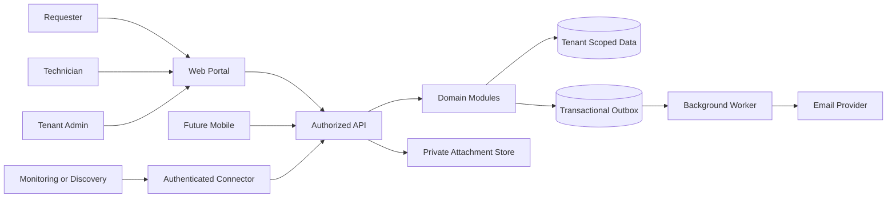
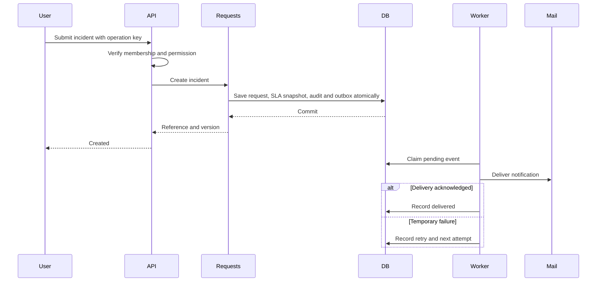
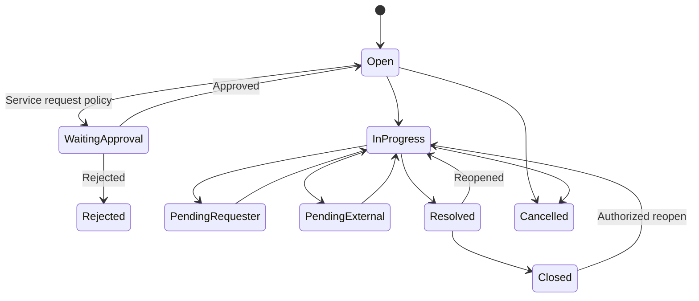
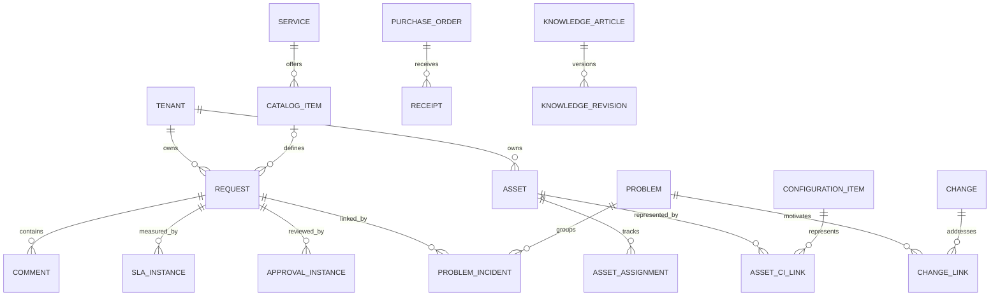

# مخططات النظام

NSC-DIAG-01 | مخططات تصميم مفاهيمي | 2026-11-09. المخططات تفسر الوثائق ولا تصف بنية منشورة. الأسماء قصيرة لتسهيل العرض في قارئ Markdown يدعم Mermaid.

## السياق وحدود الثقة

كل سهم بين قناة خارجية وAPI أو موصل نقطة تحقق هوية وصلاحية ومدخلات. ظهور قاعدة واحدة لا يعني أن المؤسسات تشترك في صلاحية البيانات.

## تسلسل إنشاء حادث وإشعاره

## دورة طلب مختصرة

المخطط مختصر؛ شروط الإلغاء من بقية الحالات وقواعد الوقت والتفويض مرجعها [دورات العمل](../02-design/03-workflows.md)، وليس كل سهم متاحًا لكل دور.

## العلاقات الرئيسية

هذه عينة علاقات وليست ERD فيزيائيًا كاملًا. توجد قيود إضافية مثل عهدة فعالة واحدة وتطابق المؤسسة في [نموذج البيانات](../02-design/02-data-model.md).
